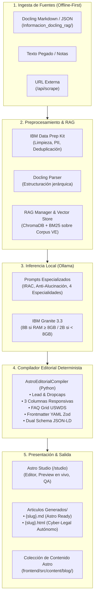

# PLAN MAESTRO UNIFICADO DE ARQUITECTURA Y EJECUCIÓN — JullEditor v4.0

> **Documento Canónico Unificado para Agentes IA y Desarrolladores**  
> **Estado:** COMPLETADO AL 100% · EN PRODUCCIÓN (v4.0.0)  
> **Ubicación Canónica:** `.agents/PLAN_MAESTRO.md` (unificación de todos los planes históricos)  
> **Repositorio:** `julljoll/JullEditor` (`main`)  
> **Lanzador Canónico en 1 Clic:** `ejecutar_local.bat` (Windows) / `python run.py` (Linux/macOS)  
> **Arquitectura:** Offline-First · Python 3.12 (FastAPI) · IBM Granite 3.3 vía Ollama · Astro Framework (`frontend/`) · USWDS Design System

---

## 1. VISIÓN EJECUTIVA Y PRINCIPIOS RECTORES

JullEditor es una **estación pericial y editorial de redacción de artículos técnicos, jurídicos y de ciberseguridad forense**, concebida para operar **100% en local y offline** utilizando el modelo **IBM Granite 3.3** a través de **Ollama**.

El sistema integra:
1. **Compilación Editorial Determinista para Astro**: Transforma la salida del modelo de lenguaje en maquetación de periódico de gran tirada (3 columnas responsivas, dropcaps, pull quotes, entradillas y cajas de lección) lista para las Colecciones de Contenido de Astro (`frontend/src/content/blog/`).
2. **Auto-Arranque y Despliegue en 1 Clic (`ejecutar_local.bat`)**: Unifica en un único script desatendido la comprobación e instalación de Python 3.12, entorno virtual `.venv`, dependencias de `requirements.txt`, motor Ollama, descarga del modelo Granite según la memoria RAM, e inicio simultáneo del backend FastAPI y la interfaz Astro en `http://localhost:3000`.
3. **Cero Alucinación Normativa (Venezuela Exclusiva)**: Anclaje estricto en el corpus jurídico nacional (`Informacion_docling_rag/`) que incluye la CRBV, Códigos (Civil, Penal, Comercio, Procesal), Leyes Especiales (Delitos Informáticos, Mensajes de Datos y Firmas Electrónicas, Infogobierno), Manual Único de Cadena de Custodia de Evidencias (2017) y jurisprudencia verificada de las Salas del TSJ.
4. **Sistema de Diseño Oficial USWDS sin Emojis**: Interfaz operativa en Modo Oscuro Estricto (WCAG 2.1 AA/AAA) con iconos SVG nativos de USWDS (`UswdsIcon.astro`), paleta Cyber-Legal de alto contraste y reglas de impresión pericial `@media print` en tamaño oficio.
5. **Extractor y Parser de Artículos Externos**: Capacidad de pegar enlaces de blogs o noticias para extraer su contenido limpio vía `/backend-api/api/scrape`, reestructurarlo con metadatos de autoría y regenerarlo bajo las directrices editoriales del proyecto.
6. **Persistencia Dual Automática (`Articulos Generados/`)**: Todo artículo redactado se guarda simultáneamente en formato `.md` (con Frontmatter YAML canónico) y en `.html` (autónomo, estilizado y con esquemas JSON-LD `TechArticle` y `FAQPage`).

---

## 2. ARQUITECTURA TÉCNICA GLOBAL



---

## 3. COMPILADOR EDITORIAL DETERMINISTA (`AstroEditorialCompiler`)

### 3.1 Principio Rector
> **¿Por qué NO pedirle a un SLM local (IBM Granite 3.3 de 2B/8B) que redacte directamente cientos de líneas de HTML anidado complejo?**  
> Forzar a un modelo de lenguaje local a generar decenas de etiquetas `<div>`, clases CSS, grid USWDS y dropcaps mientras mantiene la coherencia pericial y legal produce etiquetas sin cerrar, sangrías erróneas que Markdown interpreta como bloques de código literal y pérdida de consistencia.

**Solución Implementada:**
1. **IBM Granite 3.3** genera un artículo en **Markdown Semántico Puro**:
   - Answer-First en las primeras 100 palabras.
   - Subtítulos H2 con intención de búsqueda SEO.
   - Párrafos rítmicos de 45-65 palabras.
   - Términos clave resaltados en **negrita**.
   - Cita destacada pericial.
   - Cajas de resumen y checklist accionable.
   - Marco legal venezolano estricto con citas literales.
   - FAQ de 3 preguntas en formato `**P: ...**` y `**R: ...**`.
2. **`AstroEditorialCompiler` (Python)** ensambla el Markdown de forma matemática y 100% determinista:
   - Envuelve la apertura en `<div class="editorial-lead">`.
   - Inyecta la letra capitular `<span class="editorial-dropcap">X</span>` en el primer carácter del cuerpo.
   - Extrae y posiciona la cita pericial en `<div class="editorial-quote">`.
   - Divide las secciones H2 en columnas dentro de `<div class="editorial-three-columns">`.
   - Convierte el bloque de FAQ en la cuadrícula responsiva USWDS (`<div class="grid-row grid-gap-2">`).
   - Genera el Frontmatter YAML exacto según el esquema Zod de Astro.
   - Elimina encabezados `# H1` duplicados (el layout de Astro renderiza el H1 desde el frontmatter).
   - Inyecta el doble bloque Schema.org (`TechArticle` con 15 campos y `FAQPage`).

### 3.2 Esquema Zod Oficial de Astro (`frontend/src/content.config.ts`)

```typescript
import { defineCollection, z } from 'astro:content';

const blog = defineCollection({
  type: 'content',
  schema: ({ image }) => z.object({
    title: z.string().max(75, "El título SEO no debe exceder 75 caracteres"),
    title_en: z.string().optional(),
    description: z.string().min(100).max(165),
    pubDate: z.coerce.date(),
    updatedDate: z.coerce.date().optional(),
    author: z.string().default("Equipo Pericial sha256.us"),
    tags: z.array(z.string()).min(1).max(8),
    categories: z.array(z.string()).default(["Ciberseguridad"]),
    heroImage: z.string().optional(),
    seoKeyword: z.string().optional(),
    readingTime: z.number().int().positive().default(5),
    featured: z.boolean().default(false),
    draft: z.boolean().default(false),
    lang: z.enum(['es', 'en']).default('es'),
  }),
});

export const collections = { blog };
```

---

## 4. LANZADOR UNIFICADO 1-CLIC (`ejecutar_local.bat`)

Para eliminar contradicciones y dependencias de múltiples archivos, el proyecto cuenta con un único ejecutable en la raíz:

```
ejecutar_local.bat
```

### Secuencia de Ejecución Interna:
1. **Verificación de Python**: Comprueba `py.exe` o `python.exe` (versión $\ge$ 3.10). Si no existe, ejecuta `winget install Python.Python.3.12 --silent` con fallback automático a la descarga e instalación silenciosa del instalador oficial desde `python.org` con `PrependPath=1`.
2. **Entorno Virtual y Dependencias**: Crea automáticamente `.venv` si no existe e instala desatendidamente los paquetes requeridos desde `requirements.txt` (`fastapi`, `uvicorn`, `httpx`, `pydantic`, `pyyaml`, `chromadb`, etc.).
3. **Motor Ollama**: Detecta si Ollama está en `PATH` o en `AppData/Program Files`. Si no está, lo instala vía winget o mediante el instalador oficial silencioso (`OllamaSetup.exe /SILENT /NORESTART`). Comprueba si el daemon responde en `http://localhost:11434`; si no, lanza `start /B ollama serve`.
4. **Análisis de Hardware y Asignación de Modelo**: Mide la memoria RAM física mediante CIM/WMI de PowerShell:
   - **$\ge$ 8 GB RAM**: Asigna y descarga `granite3.3:8b`.
   - **< 8 GB RAM**: Asigna y descarga `granite3.3:2b`.
   - Comprueba con `ollama list` si el modelo ya está instalado localmente para evitar descargas redundantes.
5. **Arranque del Orquestador**: Invoca `.venv\Scripts\python.exe run.py`, levantando FastAPI en el puerto 8000, Astro en el puerto 3000 y abriendo el navegador predeterminado en `http://localhost:3000`.

---

## 5. SISTEMA DE DISEÑO USWDS DARK-ONLY (WCAG 2.1 AA/AAA)

El frontend opera bajo los estándares oficiales del **U.S. Web Design System (USWDS)** adaptados a modo oscuro pericial:
- **Cero Emojis**: Todos los indicadores y botones utilizan iconos SVG vectoriales del catálogo de USWDS mediante el componente `UswdsIcon.astro` (iconos autorizados: `shield`, `check_circle`, `warning`, `error`, `content_copy`, `download`, `refresh`, `code`, `article`, `file_present`, etc.).
- **Paleta Cyber-Legal**:
  - Fondo App: `--bg-app` (`#0B0E12`)
  - Paneles: `--bg-panel` (`#12161C`)
  - Tarjetas / Inputs: `--bg-elevated` (`#181D25`)
  - Lienzo de Lectura: `--bg-reading` (`#0F1318`)
  - Oro Primario: `--color-primary` (`#F2C230`) y Oro Foco (`#FFD54A`)
  - Verde Pericial: `--color-secondary` (`#3DD68C`)
- **Regla de Impresión Oficio**: `@media print` fuerza fondo blanco y texto en negro absoluto (`#000000`) formateado en dimensiones legales venezolanas (216 mm × 330 mm).

---

## 6. MAPA DE RUTAS Y ENDPOINTS DE LA API (FastAPI)

| Método | Endpoint | Descripción |
|---|---|---|
| `GET` | `/api/health` | Estado del backend, conexión con Ollama y modelo activo |
| `POST` | `/api/generate-stream` | Generación por streaming SSE de artículos con IBM Granite |
| `POST` | `/api/stop-generation` | Detención inmediata del flujo de streaming |
| `POST` | `/api/ai-action` | Acciones directas del Studio (resumir, generar, transformar) |
| `POST` | `/api/ai-chat` | Chat interactivo del copiloto editorial pericial |
| `POST` | `/api/scrape` | Extractor y parser de artículos web externos |
| `POST` | `/api/save-generated-article` | Persistencia dual (.md y .html) en `Articulos Generados/` |
| `GET` | `/api/articles-history` | Listado del inventario de artículos guardados |
| `GET` | `/api/articles-history/{filename}` | Lectura del contenido de un artículo específico |
| `POST` | `/api/seo-audit` | Auditoría de 25 puntos de control de calidad SEO/Legal |
| `POST` | `/api/export/publish` | Publicación de artículos hacia `frontend/src/content/blog/` |

---

## 7. MATRIZ DE FASES HISTÓRICAS COMPLETADAS (DoD)

| Fase | Alcance | Estado | Criterio de Aceptación Verificado |
|---|---|---|---|
| **Fase 0** | Higiene y Desacoplamiento | Completada | Monorepo limpio, ramas unificadas en `main`, .gitignore robusto. |
| **Fase 1** | Backend 100% Python | Completada | Toda la lógica de negocio migrada a FastAPI/Python puro. |
| **Fase 2** | Corpus y RAG Legal Venezuela | Completada | 96 fuentes en `Informacion_docling_rag/` indexadas en ChromaDB + BM25. |
| **Fase 3** | Pipeline Agéntico de Redacción | Completada | Inferencia streaming con IBM Granite 3.3, contexto cerrado anti-alucinación. |
| **Fase 4** | Compilador Editorial Astro | Completada | `AstroEditorialCompiler` determinista con 3 columnas, dropcaps, quotes y FAQ USWDS. |
| **Fase 5** | Frontend Astro & Studio | Completada | Interfaz completa con Studio editor, inventario, vista previa y tokens USWDS. |
| **Fase 6** | Extractor URL & Persistencia Dual | Completada | Scraping de blogs externos (`/api/scrape`) y guardado dual .md/.html en `Articulos Generados/`. |
| **Fase 7** | Launcher 1-Clic & Limpieza | Completada | Creación de `ejecutar_local.bat`, eliminación de scripts obsoletos y 149/149 tests verdes. |

---

## 8. COMANDOS DE OPERACIÓN Y VERIFICACIÓN

```bash
# 1. Ejecución completa 1-clic en Windows (usuarios y producción)
ejecutar_local.bat

# 2. Ejecución manual del orquestador (desarrollo multiplataforma)
python run.py

# 3. Ejecución de la suite completa de pruebas (149 tests)
.venv/bin/pytest           # Linux/macOS
.\.venv\Scripts\pytest     # Windows

# 4. Verificación del build del frontend Astro
cd frontend && npm run build
```
