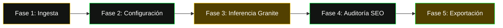

# Blog Offline Workflow (Flujo de Trabajo Canónico Local)

Este skill define la secuencia maestra de operaciones para operar la suite de redacción editorial sin requerir internet en ningún punto del proceso.

## 1. Mapa de Fases del Pipeline Canónico



---

## 2. Descripción de las 5 Fases

### Fase 1: Ingesta de Información (Docling .MD / Texto Directo)
- **Protocolo Principal (Recomendado)**:
  - **Opción A (Docling .MD)**: Arrastrar y soltar o seleccionar el archivo `.md` exportado por Docling desde `Informacion_docling_rag/` o cualquier fuente. El sistema extrae el título H1, elimina artefactos OCR y selecciona la especialidad temática automáticamente.
  - **Opción B (Texto Pegado)**: Copiar y pegar el texto del artículo original, borrador o notas en el área de **"Texto Fuente / Notas Base"**.
- Si se cuenta con una URL original de procedencia, escribirla en el campo correspondiente (para que quede registrada en la sección de Derechos de Autor al final).
- Si se utiliza el modo URL con internet activo, el sistema extraerá automáticamente la imagen destacada original si está presente. En cualquier otro caso, la colocación de imágenes se realiza manualmente durante la publicación.

### Fase 2: Configuración Editorial
- **Especialidad Temática**: Seleccionar una de las 4 especialidades:
  - 🛡️ *Ciberseguridad & Delitos Informáticos*
  - 🧠 *Inteligencia Artificial & Gobernanza de Datos*
  - ⚖️ *Derecho Digital & Firmas Electrónicas*
  - 🔬 *Ciencia, Innovación & Telecomunicaciones*
- **Tono**: Seleccionar *Conversacional Ágil* (recomendado para blog) o *Analítico Pericial*.
- **Extensión**: Seleccionar ~1000 palabras (estándar) o ~1500 palabras (artículo pilar).

### Fase 3: Inferencia Local con IBM Granite
- Hacer clic en **"Redactar Artículo"**.
- El backend envía el prompt canónico estructurado a Ollama (`http://localhost:11434/api/generate`) mediante SSE (Server-Sent Events) en streaming.
- **Rendimiento estimado en CPU**: 15 a 45 tokens/segundo (tiempo total ~45-90 segundos).

### Fase 4: Auditoría y Validación de Métricas
- El panel lateral derecho ejecuta automáticamente el cálculo de métricas en tiempo real:
  - Score SEO Global (Objetivo >= 85%).
  - Conteo de palabras y tiempo de lectura.
  - Densidad y repetición de palabras clave resaltadas en negrita.
  - Validación de Schemas JSON-LD (`TechArticle` y `FAQPage`).

### Fase 5: Exportación y Publicación
- **Para WordPress**: Hacer clic en **"Copiar p/ WordPress"** (copia el HTML limpio con estilos integrados).
- **Para Repositorios**: Hacer clic en **".MD"** para copiar el Markdown puro.
- **Para Imagen Extraída**: Si se extrajo una imagen de la URL, hacer clic en **"Descargar Imagen"**. Del resto, la maquetación visual e inserción de imágenes se gestiona manualmente al publicar.

---

## 3. Comprobación Rápida del Entorno Local

Para verificar que todos los servicios locales están listos:
```bash
# 1. Comprobar Ollama y modelo Granite
curl http://localhost:11434/api/tags

# 2. Iniciar servidor FastAPI
python -m uvicorn backend.app:app --host 127.0.0.1 --port 8000 --reload
```
