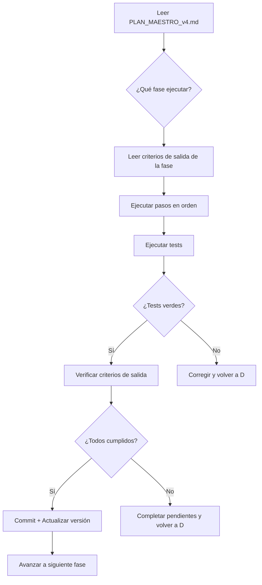

# Skill: Optimización Profesional JullEditor v4.0

## Propósito
Este skill orienta la ejecución paso a paso del **Plan Maestro de Optimización**
ubicado en `.agents/plans/PLAN_MAESTRO_v4.md`. Cualquier agente IA que active
este skill DEBE leer primero ese plan completo antes de ejecutar cualquier acción.

## Reglas de Ejecución

### 1. Orden Estricto de Fases
Las fases DEBEN ejecutarse en orden (0 → 1 → 2 → 3 → 4 → 5 → 6 → 7).
Nunca saltar una fase. La Fase 7 puede ejecutarse en paralelo con la Fase 6.

### 2. Criterios de Salida Obligatorios
Antes de avanzar a la siguiente fase, TODOS los criterios de salida de la
fase actual deben estar verificados. Si alguno falla, corregir antes de avanzar.

### 3. Tests Siempre Verdes
Después de cada cambio significativo, ejecutar:
```powershell
python run.py --test
```
Si algún test falla, corregir INMEDIATAMENTE antes de continuar.

### 4. Commits por Fase
Cada fase produce exactamente un commit con el formato:
```
<tipo>(v<X.Y.Z>): <descripción corta>
```
Tipos válidos: `chore`, `refactor`, `feat`, `fix`, `release`, `docs`.

### 5. Versionado
Actualizar `backend/version.py` y `pyproject.toml` al cerrar cada fase.

### 6. Preservar Retrocompatibilidad
Nunca romper imports existentes. Usar re-exports en `__init__.py`.
Nunca eliminar endpoints de la API sin deprecación previa.

### 7. Lectura Obligatoria Pre-Ejecución
Antes de ejecutar CUALQUIER fase, leer estos archivos:
- `.agents/plans/PLAN_MAESTRO_v4.md` (el plan completo)
- `.agents/AGENTS.md` (reglas editoriales)
- `backend/editorial_catalog.py` (fuente de verdad editorial)
- `backend/version.py` (versión actual)

### 8. Principio de Mínimo Cambio
Cada paso modifica SOLO los archivos especificados en el plan.
No "mejorar" código que no está en scope de la fase actual.

### 9. Offline-First Siempre
Toda nueva funcionalidad DEBE funcionar sin internet.
Las dependencias opcionales (ChromaDB, sentence-transformers) deben tener
fallback graceful si no están instaladas.

### 10. Anti-Alucinación por Diseño
El Agente Redactor (Fase 3) NUNCA puede citar información que no esté
en el dossier construido por el Agente Investigador.

## Flujo de Trabajo del Agente



## Archivos Clave del Proyecto

| Archivo | Rol | Cuándo leer |
|---|---|---|
| `.agents/plans/PLAN_MAESTRO_v4.md` | Plan completo | Siempre al inicio |
| `.agents/AGENTS.md` | Reglas editoriales | Siempre al inicio |
| `backend/editorial_catalog.py` | Catálogo editorial | Al modificar UI/opciones |
| `backend/version.py` | Versión SemVer | Al cerrar cada fase |
| `pyproject.toml` | Config proyecto | Al agregar dependencias |
| `requirements.txt` | Deps pip | Al agregar paquetes |
| `backend/app.py` | API FastAPI | Al modificar endpoints |
| `backend/bootstrap.py` | Auto-instalación | Al cambiar flujo de arranque |
| `run.py` | Entry point | Al agregar flags CLI |

## Comandos Frecuentes

```powershell
# Ejecutar tests
python run.py --test

# Lint con ruff
python -m ruff check backend/ run.py

# Type check con mypy
python -m mypy backend/ --ignore-missing-imports

# Servidor web (desarrollo)
python run.py --port 8000

# TUI terminal
python run.py --tui

# CLI interactivo
python run.py --cli

# Indexar corpus RAG (Fase 2+)
python run.py --index
```
