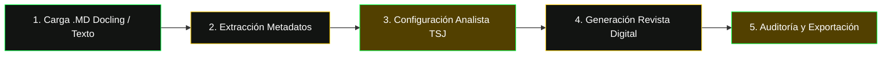

# Sentencia TSJ Analyzer (Análisis Jurisprudencial en Formato Revista Digital)

Este skill define el protocolo de análisis jurisprudencial e inferencia local con **IBM Granite** para transformar fallos judiciales del **Tribunal Supremo de Justicia de Venezuela (TSJ)** en artículos divulgativos de revista jurídica de máxima calidad editorial.

---

## 1. Flujo Canónico en 5 Pasos



### Paso 1: Carga de la Fuente
- Ingesta directa del archivo `.md` estructurado desde `Informacion_docling_rag/Jurisprudencias/` o pegado en el campo fuente.
- Se preserva el frontmatter YAML y el texto íntegro procesado por IBM Docling.

### Paso 2: Extracción Automática de Ficha Técnica
Ejecutar el script extractor para obtener la estructura limpia:
```bash
python .agents/skills/sentencia-tsj-analyzer/scripts/extract_sentencia_metadata.py "<ruta-al-archivo.md>" --pretty
```
Metadatos extraídos:
- **Sala del TSJ:** Sala de Casación Penal, Civil, Social, Constitucional, Político-Administrativa, Electoral o Plena.
- **Expediente:** Alfanumérico judicial (ej. `AA30-P-2024-000184`).
- **Número de Sentencia:** Número de identificación oficial (ej. `268`).
- **Magistrado Ponente:** Nombre completo del ponente.
- **Fecha de Decisión:** Fecha exacta de suscripción.
- **Partes Procesales:** Recurrente/Demandante y Recurrido/Demandado.
- **Materia y Delito/Asunto:** Rama jurídica y pretensión o tipo penal.
- **Tipo de Decisión:** Dispositivo literal del fallo (Desestimado, Con Lugar, Sin Lugar, etc.).
- **Leyes y Artículos Citados:** Taxativo de normas positivas venezolanas.
- **Carácter Vinculante:** Verificación estricta de Art. 335 CRBV.

### Paso 3: Configuración del Motor
- **Perfil de Voz:** `analista_tsj_revista` (ID interno)
- **Jurisdicción:** `venezuela` (exclusiva)
- **Especialidad Temática:** `forensic_law` o `sentencia_tsj`
- **Temperatura:** `0.15` (máximo rigor fáctico, cero alucinación de doctrina)
- **Modo:** 100% Offline con IBM Granite 3.3 vía Ollama.

### Paso 4: Generación con Formato Revista Digital (16 Puntos)
El modelo debe seguir la estructura editorial de revista digital:
1. Titular H1 impactante tipo revista (8-12 palabras) con el principio jurídico.
2. Meta Descripción (145-160 caracteres).
3. Ficha Técnica de la Sentencia en tabla estructurada Markdown.
4. Párrafo Answer-First GEO 2026 (40-60 palabras) con la conclusión central en **negrita**.
5. Caja `> **📌 Resumen Práctico de la Sentencia:**`
6. Caja `> **⚡ Resumen Ejecutivo en 30 Segundos:**`
7. Sección `¿Qué resolvió el TSJ en esta sentencia?` (Antecedentes e iter procesal).
8. Sección `¿Cuál es la doctrina establecida?` (Ratio decidendi y precedentes).
9. Caja pedagógica `> ### 💡 En Palabras Simples` con analogía comprensible.
10. Sección `¿Qué normas aplicó la Sala?` (Artículos exactos citados).
11. Sección `¿Cómo impacta esta decisión en la práctica?` (Litigantes, jueces y ciudadanos).
12. Sección de Votos Salvados / Concurrentes (si existen).
13. FAQ Jurídico con 3 preguntas naturales de interés práctico.
14. Ficha de Derechos de Autor y Atribución al TSJ.
15. Descargo ético profesional obligatorio.
16. Doble bloque Schema.org JSON-LD (`TechArticle` tipo LegalCommentary + `FAQPage`).

### Paso 5: Auditoría y Exportación
- Auditar con el skill `blog-quality-audit` para validar score >= 85%.
- Exportar a WordPress/Gutenberg o HTML limpio con estilos institucionales.

---

## 2. Reglas Anti-Alucinación Reforzadas

1. **Inmutabilidad del Dispositivo:** Prohibido alterar el sentido del fallo. Si la Sala declaró "Sin Lugar" o "Desestimó", es inaceptable concluir que "revocó" o declaró "Con Lugar".
2. **Cero Invención de Datos Personales o Procesales:** Prohibido inventar nombres de magistrados, fiscales, partes, abogados o números de expediente inexistentes en el texto original.
3. **Cero Invención de Artículos Legales:** Toda norma citada debe pertenecer a la legislación venezolana autorizada (`Informacion_docling_rag/`) o constar en la sentencia.
4. **Comillas Textuales:** Usar comillas latinas `«»` cuando se transcriban fragmentos literales de la parte motiva o de la doctrina asentada por la Sala.
5. **Carácter Vinculante:** Indicar con precisión técnica si la decisión tiene efectos erga omnes vinculantes (exclusivo de la Sala Constitucional según Art. 335 CRBV) o si es jurisprudencia reiterada de casación.

---

## 3. Glosario Rápido de Referencia

Consulta la anatomía exhaustiva de las sentencias en [estructura_sentencia.md](./references/estructura_sentencia.md).

- **Ratio Decidendi:** Razón jurídica determinante del fallo.
- **Obiter Dictum:** Consideración incidental de la Sala.
- **Ponencia:** Proyecto de sentencia elaborado por el Magistrado Ponente.
- **Sobreseimiento (Art. 300 COPP):** Decisión judicial que pone fin al proceso penal sin llegar a juicio oral.
- **Intervención Mínima:** Principio según el cual el Derecho Penal es la última ratio, no pudiendo criminalizarse meros incumplimientos de contratos civiles o mercantiles.
