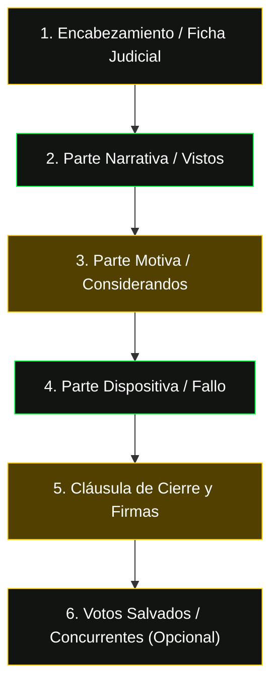

# Anatomía de una Sentencia del Tribunal Supremo de Justicia (TSJ) de Venezuela

Esta guía describe la estructura canónica de las decisiones y sentencias judiciales emanadas de las distintas Salas del Tribunal Supremo de Justicia (TSJ) de la República Bolivariana de Venezuela, procesadas mediante IBM Docling / LegalProcessor, y su traducción a un artículo explicativo de **revista digital jurídica**.

---

## 1. Las Cinco Partes Canónicas de una Sentencia del TSJ

De conformidad con el Código de Procedimiento Civil (Art. 243 CPC), el Código Orgánico Procesal Penal (Art. 346 COPP) y la Ley Orgánica del Tribunal Supremo de Justicia (LOTSJ), toda sentencia definitiva o interlocutoria con fuerza de definitiva se divide en:

### 1.1 — Encabezamiento (Identificación del Órgano y la Causa)
- **República y Tribunal:** "En nombre de la República Bolivariana de Venezuela y por autoridad de la Ley".
- **Sala Competente:** Sala Constitucional, Sala de Casación Penal, Sala de Casación Civil, Sala de Casación Social, Sala Político-Administrativa, Sala Electoral o Sala Plena.
- **Número de Expediente:** Alfanumérico judicial único (ej. `AA30-P-2024-000184` para Penal, `AA20-C-2023-000504` para Civil).
- **Número de Sentencia:** Asignado por la Secretaría de la Sala (ej. Sentencia N° 268, Sentencia N° 709).
- **Magistrado Ponente:** Quien redacta el proyecto de decisión (ej. Magistrada Elsa Janeth Gómez Moreno, Magistrado José Luis Gutiérrez Parra).
- **Partes Procesales:** Identificación precisa del recurrente/demandante/querellante y del recurrido/demandado/imputado con cédula e inscripción INPREABOGADO de apoderados.

### 1.2 — Parte Narrativa (Los Hechos y el Iter Procesal)
- **Antecedentes:** Resumen cronológico del caso desde primera instancia, pasando por la Corte de Apelaciones o Juzgado Superior.
- **El Objeto del Recurso:** Pretensión recursiva del formalizante (casación de forma, casación de fondo, amparo constitucional o recurso de interpretación).
- **Delito o Asunto Controvertido:** Tipo penal imputado (ej. Estafa, Art. 462 CP) o pretensión civil/mercantil (ej. Intimación de honorarios, desalojo, cumplimiento contractual).

### 1.3 — Parte Motiva (El Razonamiento Doctrinal y Legal)
- **Competencia:** Fundamento constitucional (Arts. 266, 334, 335 CRBV) y orgánico (LOTSJ) de la Sala para conocer del asunto.
- **Ratio Decidendi:** El principio o doctrina jurídica medular que resuelve el debate. Es el precedente o criterio interpretativo central.
- **Obiter Dicta:** Argumentos complementarios, pedagógicos o ilustrativos expresados por la Sala sin fuerza determinante directa en el fallo.
- **Normas Positivas Aplicadas:** Artículos exactos citados y analizados de las leyes venezolanas (CRBV, CP, COPP, CPC, CC, leyes especiales).
- **Jurisprudencia Previa Invocada:** Citas de fallos anteriores de la misma Sala o de la Sala Constitucional.

### 1.4 — Dispositivo (La Decisión Imperativa)
- Encabezado típicamente por la fórmula: `D E C I S I Ó N` o `DECISIÓN`.
- Pronunciamientos posibles:
  - **Desestimado por manifiestamente infundado:** El recurso carece de técnica casacional o fundamento legal.
  - **Sin Lugar:** Se confirma el fallo recurrido y no se evidencia vicio denunciado.
  - **Con Lugar:** Se anula la sentencia recurrida; puede ordenar reenvío a un tribunal de instancia o dictar fallo de fondo según la materia.
  - **Sobreseimiento Decretado:** Extinción de la acción penal (Art. 300 COPP).
  - **Inadmisible / Perecido:** Extinción procesal por falta de requisitos o caducidad del lapso.
- **Condenatoria en Costas:** Según Art. 320 CPC (materia civil) o exención legal.

### 1.5 — Cláusula de Cierre y Firmas
- Fórmula solemne: "Dada, firmada y sellada en el Salón de Audiencias / Sala de Despacho... a los [DÍA] días del mes de [MES] de [AÑO]".
- Identificación de los Magistrados suscribientes (Presidente, Vicepresidente, Integrantes y Secretario de Sala).
- **Votos Salvados o Concurrentes:** Si algún magistrado disiente del fallo (voto salvado) o coincide en el dispositivo pero con razonamiento distinto (voto concurrente).

---

## 2. Traducción al Formato de Revista Digital Educativa

El objetivo del perfil `analista_tsj_revista` no es resumir burocráticamente la sentencia, sino transformarla en un **artículo de divulgación jurídica de alto nivel** accesible para juristas, estudiantes y público general:

| Parte de la Sentencia | Sección en Revista Digital | Propósito Pedagógico |
| :--- | :--- | :--- |
| **Encabezamiento** | `📋 Ficha Técnica de la Sentencia` (Tabla) | Consulta inmediata de Sala, Ponente, Expediente y Fecha |
| **Ratio Decidendi** | `Answer-First + ¿Cuál es la doctrina establecida?` | Explicar en 50 palabras qué fijó el TSJ y por qué importa |
| **Antecedentes** | `¿Qué resolvió el TSJ en esta sentencia?` | Contextualizar los hechos de forma narrativa y amena |
| **Concepto Complejo** | `💡 En Palabras Simples` | Analogía didáctica para no abogados |
| **Fundamento Legal** | `¿Qué normas aplicó la Sala?` | Cuadro o lista de artículos exactos sin alucinación |
| **Dispositivo** | `¿Cómo impacta esta decisión en la práctica?` | Consecuencias operativas para litigantes y ciudadanos |
| **Debate Jurídico** | `Preguntas Frecuentes (FAQ)` | 3 dudas reales resueltas con rigor dogmático |
| **Transparencia** | `⚖️ Derechos de Autor y Fuente Oficial` | Enlace y cita al repositorio oficial del TSJ |

---

## 3. Reglas Estrictas Anti-Alucinación para Sentencias TSJ

1. **Inmutabilidad del Dispositivo:** Jamás alterar el sentido del fallo. Si fue "Desestimado" o "Sin Lugar", bajo ningún concepto redactar que fue "Con Lugar".
2. **Cero Nombres Ficticios:** Conservar textualmente los nombres de Magistrados y Partes procesales presentes en la fuente.
3. **Numeración Fidedigna de Artículos:** Prohibido inventar normas inexistentes en el ordenamiento jurídico venezolano o citar artículos de leyes extranjeras.
4. **Delimitación de la Vinculatoriedad:** Solo las sentencias de la **Sala Constitucional** que declaren expresamente el carácter vinculante de su doctrina (Art. 335 CRBV) tienen alcance erga omnes vinculante para todos los tribunales. Las decisiones de las demás Salas (Penal, Civil, Social) constituyen jurisprudencia reiterada o doctrina de casación, pero no precedente constitucional vinculante general salvo delegación expresa.
