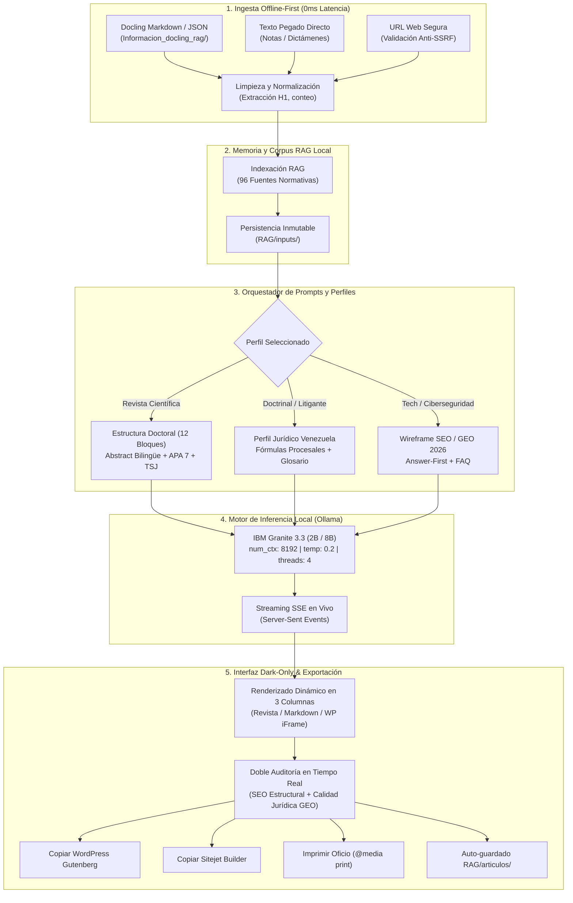

# ⚖️ JullEditor — LegalTech & Blog Studio

<p align="center">
  <strong>Estación Editorial y Pericial de Redacción de Artículos Científicos, Blog y LegalTech con IBM Granite 3.3 Local (CPU-Only)</strong><br>
  <em>Optimizada para Ciberseguridad Forense, Cadena de Custodia, Inteligencia Artificial, Derecho Digital, con enfoque exclusivo en la jurisdicción de Venezuela 🇻🇪.</em>
</p>

<p align="center">
  
  
  
  
  
  
  
</p>

---

## 📑 Tabla de Contenidos
1. [¿Para qué sirve este Proyecto?](#-1-para-qué-sirve-este-proyecto)
2. [¿Cómo funciona internamente?](#-2-cómo-funciona-internamente)
3. [¿Cómo se utiliza el Proyecto? (Manual Paso a Paso)](#-3-cómo-se-utiliza-el-proyecto-manual-paso-a-paso)
4. [Especialidades Temáticas y Marco Jurídico Soportado](#-4-especialidades-temáticas-y-marco-jurídico-soportado)
5. [Atajos de Teclado (Power Users)](#-5-atajos-de-teclado-power-users)
6. [Requisitos del Sistema e Instalación Local](#-6-requisitos-del-sistema-e-instalación)
7. [Protocolo de Verificación del Funcionamiento](#-7-protocolo-de-verificación-del-funcionamiento)
8. [Arquitectura y Estructura del Código](#-8-arquitectura-y-estructura-del-código)
9. [Laboratorio de Compatibilidad Sitejet Builder](#-9-laboratorio-de-compatibilidad-sitejet-builder)
10. [Despliegue en la Nube (Google Colab & Oracle Cloud)](#-10-despliegue-en-la-nube-google-colab--oracle-cloud)
11. [Preguntas Frecuentes (FAQ)](#-11-preguntas-frecuentes-faq)
12. [Versionado SemVer](#-12-versionado-semver)

---

## 💡 1. ¿Para qué sirve este Proyecto?

**JullEditor** es una estación de trabajo pericial y editorial concebida para transformar borradores, apuntes técnicos, peritajes, fallos jurisprudenciales o documentos estructurados de **Docling** en **artículos de nivel científico universitario y publicaciones de blog de alto impacto** optimizadas para buscadores y motores de respuesta de inteligencia artificial (**Google AI Overviews, Perplexity, ChatGPT Search**).

### 🎯 Problemas Críticos que Resuelve:
* **Cero Fuga de Información Confidencial (Privacidad Absoluta):** Funciona **100% de manera local y offline** en tu ordenador con **IBM Granite 3.3** vía **Ollama**. Ni un solo dato, contrato, expediente o nota pericial sale a servidores de terceros ni APIs comerciales.
* **Cero Alucinación Jurídica (Temperatura 0.2):** Los LLMs genéricos inventan artículos de leyes, números de gacetas o fallos inexistentes. Esta plataforma restringe estrictamente la inferencia al corpus normativo positivo real y penaliza severamente cualquier invención.
* **Publicaciones con Estándar Universitario Arbitrado:** Permite generar artículos con el rigor metodológico exigido por revistas científicas de facultades de Derecho e Informática Forense (título bilingüe, resumen estructurado / abstract, análisis dogmático, directrices ISO/NIST, jurisprudencia del TSJ y referencias en formato APA 7ma edición).
* **Exportación Directa Multi-CMS sin Pérdida de Formato:** Proporciona código HTML higienizado y enriquecido con estilos inline listo para copiar y pegar directamente en los constructores más populares (**WordPress Gutenberg, Elementor, Sitejet Builder**) o imprimir en formato físico de oficio (`@media print`).

### 👥 ¿A quién está dirigido?
* **Abogados y Consultores Legales:** Elaboración de artículos de doctrina, análisis de sentencias y compliance normativo.
* **Peritos e Ingenieros Forenses:** Publicaciones técnicas sobre evidencia digital, mismidad, hash criptográfico SHA-256 y protocolos de cadena de custodia.
* **Investigadores Académicos y Docentes:** Generación de papers y ensayos para revistas científicas arbitradas.
* **Redactores de Ciberseguridad y Tech:** Creación de guías técnicas en profundidad (Pilar SEO de 1.000 a 1.500 palabras) con microdatos Schema.org completos.

---

## ⚙️ 2. ¿Cómo funciona internamente?

El sistema combina un backend asíncrono en **FastAPI**, un motor de orquestación de prompts con perfilado dogmático, un **RAG local indexado** y una interfaz web modular de alto rendimiento construida con **Vanilla JavaScript ES6** y diseño **Dark OLED Cyber-Legal**.

### 🔄 Diagrama de Flujo del Pipeline Local:



### 🧠 Parámetros de Inferencia de IBM Granite:
* **Modelo Predeterminado:** `granite3.3:8b` (o `granite3.3:2b` para portátiles con recursos ajustados).
* **Context Window (`num_ctx`):** 8.192 tokens para soportar análisis exhaustivos y textos extensos sin truncamiento.
* **Temperatura:** `0.2` (Rigor Factual y Científico) para eliminar la invención de normativas o sentencias.
* **Hilos de CPU (`num_thread`):** 4 hilos optimizados para equilibrio entre velocidad y responsividad del sistema.
* **Persistencia en Memoria (`keep_alive`):** `30m` para evitar recargas del modelo en memoria RAM entre generaciones sucesivas.

---

## 🖥️ 3. ¿Cómo se utiliza el Proyecto? (Manual Paso a Paso)

La interfaz se divide en **3 columnas de trabajo** inspiradas en el estándar pericial **USWDS Cyber-Legal Dark Mode**:

```
┌─────────────────────────┬───────────────────────────────┬─────────────────────────┐
│ 1. PANEL DE CONTROL     │ 2. VISOR DEL ARTÍCULO         │ 3. AUDITORÍA SEO & UX   │
│ (Stepper de 4 Pasos)    │ (Lienzo Central en 3 Col.)    │ (Scorecard Doble 2026)  │
│                         │                               │                         │
│ • Modo de Ingesta       │ • Pestañas: Revista/MD/WP     │ • Score SEO Estructural │
│ • Especialidad Temática │ • Simulador Desktop/Tab/Móvil │ • Score Calidad Jurídica│
│ • Perfil de Voz y Tono  │ • Cajas Didácticas y Callouts │ • Detección Answer-First│
│ • Longitud y Temp       │ • Copiar WordPress / Sitejet  │ • Glosario y Descargo   │
│ • Botón 'Redactar'      │ • Impresión Formato Oficio    │ • Auditoría Profunda    │
└─────────────────────────┴───────────────────────────────┴─────────────────────────┘
```

### Paso 1: Seleccionar la Fuente de Origen (Columna 1)
Dispones de tres modalidades de ingesta:
1. **Docling (.MD / .JSON) [Recomendado - 0ms Latencia]:** Sube archivos procesados con Docling. Extrae automáticamente títulos limpios, elimina artefactos OCR y los almacena en `RAG/inputs/`.
2. **Pegar Texto:** Pega notas periciales, apuntes o resúmenes de leyes directamente en el editor.
3. **Enlace URL:** Introduce un enlace web. El scraper seguro de HTTPX extraerá el contenido limpiando menús y rastreadores con protección anti-SSRF.

### Paso 2: Seleccionar la Especialidad Temática (Columna 1)
Haz clic en una de las píldoras temáticas:
* **🔬 Forense & TSJ (`forensic_law`):** Evidencia digital, cadena de custodia, hash SHA-256, sentencias de la Sala Constitucional/Penal del TSJ, ISO 27037 y manual MP/CICPC 2017.
* **⚖️ Derecho Digital (`legal_tech`):** Firmas electrónicas, mensajes de datos (G.O. 37.148), validez procesal y comercio electrónico.
* **🛡️ Ciberseguridad (`cybersecurity`):** Ley Especial contra los Delitos Informáticos (G.O. 37.313), VenCERT, ISO 27001 e incidentes de seguridad.
* **🤖 IA & Datos (`ai_ethics`):** Modelos generativos, gobernanza algorítmica, soberanía tecnológica e Infogobierno (G.O. 40.274).
* **📡 Ciencia & Tech (`science_tech`):** Telecomunicaciones, computación en la nube e infraestructura crítica.

### Paso 3: Calibrar los Parámetros Editoriales (Columna 1)
* **Perfil de Voz / Tono:**
  * 🎓 **Revista Científica Arbitrada (Derecho & Computación Forense — Nivel Universidad):** Autocalibra la extensión a 1.500 palabras y temperatura 0.2 con estructura doctoral de 12 bloques.
  * ⚖️ **Abogado Venezuela:** Doctrinal (Forense/TSJ), Litigante (Rutas procesales), Explicativo (Divulgación).
  * 🌐 **Corporativo y Divulgación:** Consultor Corporativo, Conversacional, Analítico, Didáctico, Ejecutivo.
* **Extensión Objetivo:** Desde 600 palabras (Resumen Ejecutivo) hasta 2.000 palabras (Tratado Extenso). *Recomendado SEO: Pilar de 1.000 palabras*.
* **Temperatura:** Predeterminada en `0.2` para máxima fidelidad fáctica.

### Paso 4: Redacción en Vivo y Visualización (Columna 2)
* Pulsa **`Redactar Artículo`** o presiona <kbd>Ctrl</kbd> + <kbd>Enter</kbd>.
* Observa el streaming en tiempo real con indicador de palabras y sección activa.
* Si necesitas cancelar, presiona <kbd>Escape</kbd> o el botón **Detener**.
* Alterna entre las pestañas del visor:
  * **Revista:** Diseño digital fluido con tipografía editorial, cajas de notas y callouts.
  * **Markdown:** Vista de código fuente crudo listo para descargar.
  * **WordPress:** Vista previa en iframe idéntica a cómo se verá en el editor Gutenberg.
* Prueba el **Simulador Responsive** (🖥️ Escritorio 100%, 💻 Tablet 820px, 📱 Móvil 390px).

### Paso 5: Exportación e Impresión
Despliega el botón **"Copiar ▾"**:
* 📋 **Copiar:** Copia el HTML con estilos inline optimizado para pegar en WordPress Gutenberg o Classic Editor.
* 🚀 **Copiar p/ Sitejet:** HTML higienizado sin `<script>` para el constructor Sitejet Builder.
* 📦 **Kit SEO Sitejet:** Descarga un `.zip` con el HTML, Markdown, metadatos JSON y la cabecera procesada a PNG real (1200x675 px).
* 🖨️ **Imprimir (Ctrl+P):** Activa el motor `@media print` para exportar a **PDF u oficio físico** con maquetación de revista universitaria (Georgia, texto justificado, sangría francesa APA y sin barras de navegación).

### Paso 6: Verificación en el Scorecard de Auditoría (Columna 3)
La columna derecha audita simultáneamente:
1. **Calidad SEO Estructural (0-100%):** H1 (8-12 palabras), meta descripción (145-160 caracteres), H2 rítmicos, FAQ, TOC y Schema.org.
2. **Calidad Jurídica & GEO 2026 (0-100%):** Respuesta directa *Answer-First* para Google AI, descargo ético profesional, términos jurídicos del glosario y ausencia de promesas engañosas.
3. **Auditoría Profunda:** Pulsa el botón para recibir un informe determinista generado por el backend.

---

## 🏛️ 4. Especialidades Temáticas y Marco Jurídico Soportado

El sistema cuenta con un índice RAG local precargado con **96 fuentes normativas y técnicas** organizadas en `Informacion_docling_rag/`:

```text
🇻🇪 REPÚBLICA BOLIVARIANA DE VENEZUELA:
   • Constitución de la República Bolivariana de Venezuela (CRBV, Arts. 28, 60 y 110)
   • Ley Especial contra los Delitos Informáticos (G.O. Nº 37.313, 2001)
   • Decreto-Ley sobre Mensajes de Datos y Firmas Electrónicas (G.O. Nº 37.148, 2001)
   • Ley de Infogobierno (G.O. Nº 40.274, 2013) y LOCTI
   • Manual Único de Cadena de Custodia de Evidencias Físicas (MP / CICPC, Versión 2017)
   • Centro Nacional de Informática Forense (CENIF, G.O. Nº 39.847) y SUSCERTE / VenCERT
   • Línea Jurisprudencial TSJ: Sala Constitucional, Sala de Casación Penal y Civil

🌐 ESTÁNDARES INTERNACIONALES FORENSES:
   • ISO/IEC 27037:2012 (Directrices para la identificación, recolección, adquisición y preservación de evidencia digital)
   • ISO/IEC 27042:2015 (Análisis e interpretación de evidencias digitales)
   • RFC 3227 (Directrices para la recolección de evidencia en memoria volátil)
   • NIST SP 800-86 (Integración de técnicas forenses en respuesta a incidentes)
```

---

## ⌨️ 5. Atajos de Teclado (Power Users)

| Atajo | Acción |
|---|---|
| <kbd>Ctrl</kbd> + <kbd>Enter</kbd> | **Redactar / Iniciar Inferencia** |
| <kbd>Escape</kbd> | **Detener Inferencia Inmediatamente** |
| <kbd>Ctrl</kbd> + <kbd>Shift</kbd> + <kbd>C</kbd> | **Copiar con Estilos para WordPress Gutenberg** |
| <kbd>Ctrl</kbd> + <kbd>Shift</kbd> + <kbd>H</kbd> | **Copiar Código HTML Puro y Autónomo (con Estilos Inline)** |
| <kbd>Ctrl</kbd> + <kbd>Shift</kbd> + <kbd>S</kbd> | **Copiar Higienizado para Sitejet Builder** |
| <kbd>Ctrl</kbd> + <kbd>Shift</kbd> + <kbd>K</kbd> | **Generar y Descargar Kit SEO Sitejet (.ZIP)** |
| <kbd>Ctrl</kbd> + <kbd>Shift</kbd> + <kbd>M</kbd> | **Copiar Código Markdown Crudo** |
| <kbd>Ctrl</kbd> + <kbd>Shift</kbd> + <kbd>P</kbd> o <kbd>Ctrl</kbd> + <kbd>P</kbd> | **Imprimir en Formato Oficio / Revista Física** |
| <kbd>Ctrl</kbd> + <kbd>Shift</kbd> + <kbd>F</kbd> | **Seguir Flujo de Redacción (Scroll Automático)** |
| <kbd>?</kbd> | **Abrir Modal de Ayuda de Atajos de Teclado** |

---

## 💻 6. Requisitos del Sistema e Instalación

### Requisitos del Sistema:
| Componente | Requisito Recomendado | Requisito Mínimo |
|---|---|---|
| **Sistema Operativo** | Windows 10 / 11 (64-bit) | Windows 10 (64-bit) |
| **Memoria RAM** | 16 GB (para `granite3.3:8b`) | 8 GB (usando `granite3.3:2b`) |
| **Procesador (CPU)** | Intel Core i5/i7/Ryzen 5 o superior (4+ hilos) | 4 núcleos x64 |
| **Almacenamiento** | ~6 GB libres (modelo + dependencias) | ~3 GB libres |
| **Python** | Python 3.10, 3.11, 3.12 o 3.14 | Python 3.10 |
| **Ollama** | Última versión instalada | v0.3.0+ |

---

### Instalación Rápida Paso a Paso:

#### 1. Instalar Ollama en Windows
Descárgalo de [ollama.com/download/windows](https://ollama.com/download/windows) o ejecuta en PowerShell:
```powershell
winget install Ollama.Ollama
```

#### 2. Descargar el Modelo IBM Granite 3.3
Abre PowerShell y ejecuta:
```powershell
ollama pull granite3.3:8b
```
*(Opcional: Si tu equipo tiene 8 GB de RAM o deseas máxima velocidad en CPU livianas, descarga `ollama pull granite3.3:2b`)*.

#### 3. Instalar Dependencias de Python
En la raíz del proyecto, ejecuta:
```powershell
pip install -r requirements.txt
```

#### 4. Iniciar la Aplicación con 1 Clic
Haz doble clic en **`start.bat`** o **`crear_articulo.bat`**. Ambos son simples *puentes* de Windows que únicamente localizan el intérprete de Python y delegan toda la lógica al orquestador **100% Python** (`run.py`):
```bash
python run.py                    # Servidor web FastAPI + navegador (equivale a start.bat)
python run.py --cli              # Generador interactivo de artículos jurídico-científicos (equivale a crear_articulo.bat)
python run.py --tui              # Interfaz TUI Textual canónica (v3.3.0): flujo editorial completo en terminal Python
python run.py --file <ruta.md>   # CLI precargando un documento del corpus
python run.py --test             # Suite completa de pruebas con pytest
```
El lanzador verificará el entorno, levantará Ollama si no está activo, ejecutará el servidor FastAPI y abrirá automáticamente tu navegador en:  
👉 **`http://127.0.0.1:8000`**

---

## 🧪 7. Protocolo de Verificación del Funcionamiento

Para verificar que todos los subsistemas del proyecto funcionan al 100%, sigue estos sencillos pasos:

### Paso 1: Ejecutar la Batería Automatizada de Pruebas (Pytest)
Ejecuta desde la raíz del proyecto (100% Python):
```bash
python run.py --test        # o directamente: python -m pytest -v
```
**Resultado esperado:**
* **48 pruebas pasando (100% verde)** en menos de 3 segundos.
* Cobertura completa: endpoints de FastAPI, rechazo anti-SSRF, parseo de Docling, perfiles jurídicos de Venezuela, perfil de revista científica arbitrada, tokens dark-only CSS y reglas de impresión.

### Paso 2: Comprobar el Endpoint de Salud (Healthcheck)
Ejecuta en tu terminal o abre en el navegador:
```powershell
curl http://127.0.0.1:8000/api/health
```
**Respuesta JSON esperada:**
```json
{
  "status": "online",
  "ollama_url": "http://localhost:11434",
  "models": ["granite3.3:8b", "granite3.3:2b"],
  "granite_installed": true,
  "default_model": "granite3.3:2b",
  "num_ctx": 8192,
  "num_thread": 4,
  "keep_alive": "30m",
  "jurisdiction": "auto"
}
```

### Paso 3: Prueba de Generación en Vivo
1. Abre `http://127.0.0.1:8000`.
2. En la pestaña **Pegar Texto**, escribe: *"Análisis de la evidencia digital y el valor probatorio del hash SHA-256 en Venezuela"*.
3. En el Paso 2, selecciona **Forense & TSJ**.
4. En el Paso 3, selecciona **Revista Científica Arbitrada**.
5. Presiona **Redactar Artículo** (<kbd>Ctrl</kbd> + <kbd>Enter</kbd>).
6. Verifica que la generación comience de inmediato, que aparezca la tarjeta azul de **Abstract Científico** y que el scorecard alcance un índice excelente.

---

## 📂 8. Arquitectura y Estructura del Código

```text
├── backend/                      # Servidor FastAPI y motores periciales
│   ├── app.py                    # Endpoints FastAPI, CORS, streaming SSE y healthcheck
│   ├── prompts.py                # Ensamblado de prompts, wireframe SEO y estructura doctoral
│   ├── legal_profiles.py         # Perfiles de voz jurídica venezolana, revista científica y glosario forense
│   ├── legal_validator.py        # Validador de calidad jurídica, calcos y ética profesional
│   ├── seo_validator.py          # Validador determinista SEO, legibilidad y Schema.org
│   ├── rag_manager.py            # Gestor RAG, recuperación ponderada e historial inmutable
│   ├── docling_parser.py         # Parser y extractor limpio de Markdown/JSON de Docling
│   ├── scraper.py                # Extractor HTTPX seguro con validación estricta anti-SSRF
│   ├── image_generator.py        # Generador de cabeceras vectoriales SVG 16:9
│   ├── editorial_catalog.py      # Fuente única de verdad: temas, 12 tonos VE, jurisdicciones y modelos (CLI/TUI/Web/API)
│   ├── cli_generator.py          # Asistente interactivo del .bat (espejo 1:1 de la GUI, Venezuela exclusivo)
│   ├── tui_app.py                # Interfaz TUI Textual canónica (python run.py --tui), flujo editorial completo en Python
│   ├── version.py                # Versión SemVer canónica (__version__ / get_tag())
│   ├── logger_config.py          # Sistema de logs con rotación en logs/app.log
│   └── data/
│       └── legal_corpus_ve.json  # Corpus normativo venezolano estructurado
├── frontend/                     # Interfaz web modular Dark-Only ES6
│   ├── index.html                # Layout semántico en 3 columnas y stepper de 4 pasos
│   ├── sitejet-lab.html          # Laboratorio de calibración visual Sitejet Builder
│   ├── favicon.svg               # Ícono de terminal pericial
│   ├── manifest.json             # Manifest de aplicación web
│   ├── css/
│   │   ├── style.css             # Tokens Dark OLED, modo revista y @media print
│   │   ├── fonts.css             # Tipografías e iconos locales (0ms CDN)
│   │   └── bootstrap.min.css     # Framework base local
│   ├── fonts/                    # Archivos de fuentes locales (Geist, Fira, Outfit)
│   └── js/
│       ├── app.js                # Orquestador principal y sincronización de estado
│       └── modules/              # Módulos especializados
│           ├── live-preview.js       # Gestor de vista previa y seguimiento de streaming
│           ├── creation-flow.js      # Controlador de pasos del stepper (1 a 4)
│           ├── toolbar-menu.js       # Menús contextuales y dropdowns accesibles
│           ├── markdown-renderer.js  # Renderizador Markdown con callouts y tarjetas científicas
│           ├── wordpress-exporter.js # Exportador Gutenberg con inline styles e impresión
│           ├── sitejet-exporter.js   # Exportador higienizado Sitejet y generador de ZIP
│           ├── seo-audit.js          # Scorecards SEO y calidad jurídica en tiempo real
│           ├── article-generator.js  # Cliente SSE para streaming con Ollama
│           ├── docling-handler.js    # Manejador de subida drag & drop Docling
│           ├── scraper-handler.js    # Controlador de ingesta por URL
│           ├── article-history.js    # Explorador del historial de artículos RAG
│           ├── health-check.js       # Monitor de estado de Ollama y Granite
│           └── keyboard-shortcuts.js # Atajos de teclado con navegación accesible
├── RAG/                          # Memoria persistente local
│   ├── inputs/                   # Fuentes cargadas respaldadas con timestamp
│   └── articulos/                # Artículos terminados archivados con YAML Frontmatter
├── Informacion_docling_rag/      # 96 documentos normativos indexados (12 categorías jurídicas)
├── tests/                        # Suite de 48 pruebas automatizadas (pytest)
│   ├── test_api_endpoints.py     # Pruebas de API, SSRF, UI, tokens dark y print styles
│   ├── test_legal_profiles.py    # Pruebas de perfiles jurídicos, revista científica y glosarios
│   ├── test_prompts.py           # Pruebas de inyección de prompts y reglas GEO 2026
│   ├── test_docling_parser.py    # Pruebas de extracción y limpieza Docling
│   └── test_rag_manager.py       # Pruebas de recuperación RAG y persistencia YAML
├── logs/                         # Registro histórico de actividad
├── requirements.txt              # Requerimientos de Python
├── run.py                        # Orquestador 100% Python (web / CLI / tests)
├── crear_articulo.bat            # Puente de 1 clic → python run.py --cli (sin lógica propia)
└── start.bat                     # Puente de 1 clic → python run.py (sin lógica propia)
```

---

## 🧪 9. Laboratorio de Compatibilidad Sitejet Builder

Para validar la perfecta renderización en **Sitejet Builder** (constructor de sitios web de cPanel / Namecheap), la aplicación incluye un laboratorio de pruebas visuales:
* Abre en tu navegador: **`http://127.0.0.1:8000/sitejet-lab.html`**
* Te permite probar en tiempo real:
  * Preservación de cajas destacadas (*Callouts* de resumen, notas y advertencias).
  * Tablas estilizadas con bordes sutiles y padding equilibrado.
  * Jerarquía H1-H3 sin alteraciones por el reseteador CSS de Sitejet.
  * Generación y descarga en vivo de Kits `.ZIP`.

---

## ☁️ 10. Despliegue en la Nube (Google Colab & Oracle Cloud)

Granite Blog Writer v3.3.0 está arquitecturado para funcionar con paridad 1:1 tanto en local como en la nube.

### 🚀 Opción A: Google Colab (Ejecución Instantánea con Aceleración GPU)
Ideal para redacción de alta velocidad sin consumir recursos locales de tu máquina:
1. Abre el notebook oficial: [`notebooks/granite_blog_colab.ipynb`](notebooks/granite_blog_colab.ipynb) en **Google Colab**.
2. Selecciona **Entorno de ejecución > Cambiar tipo de entorno de ejecución > GPU T4** (o CPU estándar gratuita).
3. Ejecuta secuencialmente las celdas guiadas:
   * **Paso 1:** Instala y levanta el demonio de Ollama en background.
   * **Paso 2:** Descarga `granite3.3:2b` (ultrarrápido) o `granite3.3:8b` (calidad pericial).
   * **Paso 3:** Clona el repositorio e instala `requirements-colab.txt`.
   * **Paso 4 & 5:** Configura variables de entorno y levanta el servidor web con puerto expuesto mediante túnel seguro de Google Colab o Ngrok.

### 🏢 Opción B: Oracle Cloud Infrastructure (Always Free VM con Docker & Nginx)
Para desplegar un centro pericial accesible 24/7 en una instancia gratuita de Oracle Cloud (Ubuntu 22.04/24.04 LTS en arquitectura x86_64 o ARM Ampere):

```bash
# 1. Clonar el repositorio en la instancia de Oracle Cloud
git clone https://github.com/tu-usuario/Creador-de-Articulos-Blog-con-Granite.git /opt/granite-blog
cd /opt/granite-blog

# 2. Instalar dependencias e iniciar con el orquestador 100% Python
pip install -r requirements.txt
python run.py --port 8000
```

**Lo que realiza el script automáticamente:**
* Instala **Docker Engine** y **Docker Compose Plugin**.
* Abre los puertos necesarios en el cortafuegos `iptables` (**80, 443, 8000**).
* Levanta el ecosistema contenerizado:
  * **`granite-ollama`**: Motor de inferencia local persistente.
  * **`granite-blog-app`**: Servidor FastAPI asíncrono con `requirements-cloud.txt`.
  * **`granite-nginx`**: Reverse proxy con configuración especial para **Server-Sent Events (SSE) sin buffering**.
* Descarga y precarga el modelo `granite3.3:8b`.
* Habilita el servicio de inicio automático del sistema `granite-blog.service` para `systemd`.

---

## ❓ 11. Preguntas Frecuentes (FAQ)

<details>
<summary><strong>¿Puedo utilizar este sistema totalmente sin conexión a internet?</strong></summary>
<strong>Sí, al 100%.</strong> IBM Granite 3.3 opera localmente en tu procesador a través de Ollama. Si utilizas la ingesta de archivos Docling (.MD/.JSON) o el pegado directo de texto, la aplicación no realiza ninguna solicitud a internet. Las fuentes tipográficas y los iconos están integrados localmente en la carpeta <code>frontend/fonts/</code>.
</details>

<details>
<summary><strong>¿Qué diferencia hay entre "Copiar p/ WordPress" y "Copiar p/ Sitejet"?</strong></summary>
<strong>WordPress (Gutenberg):</strong> Genera HTML enriquecido con estilos específicos que los bloques de párrafo, encabezado y tabla de Gutenberg reconocen de forma nativa manteniendo el diseño.  
<strong>Sitejet Builder:</strong> Constructor visual estricto que requiere etiquetas HTML limpias con estilos inline directos y sin scripts, evitando que su motor de sanitización elimine componentes visuales.
</details>

<details>
<summary><strong>¿Qué ventajas tiene el perfil "Revista Científica Arbitrada"?</strong></summary>
Estructura el artículo conforme al estándar de publicaciones universitarias internacionales: genera un <strong>Abstract estructurado bilingüe</strong> (Objetivo, Metodología, Resultados, Conclusiones), cita directrices periciales internacionales (<strong>ISO/IEC 27037, RFC 3227</strong>), contrasta con el <strong>Manual Único de Cadena de Custodia de Venezuela (2017)</strong>, analiza jurisprudencia del <strong>TSJ</strong>, aplica referencias en formato <strong>APA 7ma edición</strong> y microdatos Schema.org <code>ScholarlyArticle</code>.
</details>

<details>
<summary><strong>¿Cómo funciona la impresión en formato oficio (@media print)?</strong></summary>
Al presionar <kbd>Ctrl</kbd> + <kbd>P</kbd> o seleccionar <em>Imprimir</em> en el menú, la hoja de estilos <code>@media print</code> oculta automáticamente todos los paneles de control, barras de navegación y botones, ajustando el contenido a tamaño carta/oficio con tipografía serifa académica (Georgia), texto justificado, control de saltos de página y sangría francesa en las referencias.
</details>

<details>
<summary><strong>¿Por qué la temperatura recomendada es 0.2?</strong></summary>
En áreas técnicas y jurídicas (YMYL), temperaturas mayores a 0.5 aumentan exponencialmente la probabilidad de que el modelo alucine normativas, confunda artículos de leyes o invente jurisprudencia. Con <strong>0.2 (Rigor Factual)</strong>, IBM Granite 3.3 se ciñe estrictamente al contexto suministrado y al corpus legal positivo verificado.
</details>

<details>
<summary><strong>¿Qué modelo de Granite debo elegir (2B vs 8B)?</strong></summary>
• <strong>granite3.3:8b (Recomendado):</strong> Mayor riqueza léxica, razonamiento dogmático superior y redacción pericial profunda. Requiere ~8-10 GB de RAM disponible.<br>
• <strong>granite3.3:2b:</strong> Ultrarrápido, ideal para ordenadores portátiles o equipos con 8 GB de RAM total. Proporciona excelente síntesis técnica con un consumo inferior a 2.5 GB de RAM.
</details>

---

## 🏷️ 12. Versionado SemVer

Este proyecto adhiere estrictamente a [Semantic Versioning 2.0.0](https://semver.org/lang/es/): formato `MAJOR.MINOR.PATCH` (con sufijos opcionales `-PRERELEASE` y `+BUILD`). La versión canónica vive en `backend/version.py` (`__version__`) y se propaga automáticamente a FastAPI (`/api/health`, OpenAPI), banner CLI, marca de agua de artículos y `pyproject.toml`.

**GitHub muestra la versión actual en el panel derecho del repositorio leyendo las *Tags* y *Releases*.** Para publicar una nueva versión:

```bash
# 1. Actualizar backend/version.py y pyproject.toml según SemVer:
#    - MAJOR: cambios incompatibles de API/arquitectura
#    - MINOR: funcionalidad retrocompatible (p.ej. paridad CLI/GUI → 3.1.0)
#    - PATCH: correcciones retrocompatibles
# 2. Documentar en CHANGELOG.md (formato Keep a Changelog)
# 3. Etiquetar (la tag debe empezar con "v" + la versión exacta) y subir:
git commit -am "chore(release): v3.3.0"
git tag -a v3.3.0 -m "JullEditor v3.3.0 — Núcleo 100% Python: catálogo editorial unificado + TUI Textual"
git push origin main --follow-tags
# 4. (Opcional) Crear Release en GitHub desde esa tag para que aparezca
#    como "Latest" en la página del repositorio.
```

> **Actual:** `v3.3.0` (2026-10-25) — Fase 1 del plan de optimización: `editorial_catalog.py` como fuente única de verdad (temas, 12 tonos VE, jurisdicciones, modelos) compartida por CLI `.bat`, TUI Textual (`python run.py --tui`), GUI web y API `/api/editorial-options`. Previas: `v3.2.1` — lenguaje unificado a Python (.bat sin lógica); `v3.2.0` — Venezuela exclusivo; `v3.1.0` — versionado SemVer centralizado.


---

<p align="center">
  <strong>Desarrollado con arquitectura Cyber-Legal Blueprint · Cumplimiento de estándares periciales, SEO / GEO 2026 y accesibilidad WCAG 2.1 AAA</strong>
</p>
