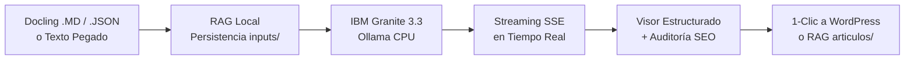

# 🇻🇪 Granite Blog Writer & LegalTech Studio

<p align="center">
  <strong>Estación Editorial y Pericial de Redacción de Artículos de Blog con IBM Granite Local (CPU-Only)</strong><br>
  <em>Optimizada para Ciberseguridad, Inteligencia Artificial, Ciencia de Datos y Legislación Venezolana.</em>
</p>

<p align="center">
  
  
  
  
  
</p>

---

## 💡 ¿Qué es este Proyecto?

**Granite Blog Writer** es una aplicación web local de nivel profesional que transforma documentos técnicos, investigaciones, peritajes o enlaces web en **artículos de blog de alto impacto editorial y posicionamiento SEO**.

### 🌟 Pilares Fundamentales:
1. **100% Offline y Privado (0ms Latencia de Red):** Procesa todo en la CPU de tu equipo con **IBM Granite 3.3** vía **Ollama**. No envía datos a la nube ni requiere conexión a internet para redactar.
2. **Cero Alucinación Jurídica:** Motor RAG local que fundamenta los textos exclusivamente en la **normativa venezolana real** (Constitución CRBV, Ley de Delitos Informáticos, Ley de Infogobierno y Mensajes de Datos) e indexa documentos periciales locales.
3. **Formato SEO Blog PDF Estricto:** Estructura con *Answer-First*, encabezados H1/H2 rítmicos, palabras clave en negrita, microdatos Schema.org (`TechArticle` y `FAQPage`) y cajas de síntesis ejecutiva.
4. **Copiado Inmediato para WordPress:** Genera código HTML con estilos compatibles con **Gutenberg** y **Classic Editor**, listo para publicar en 1 solo clic sin desconfigurar fuentes ni colores.

---

## 🔄 Flujo de Trabajo



---

## 💻 Requisitos del Sistema

| Componente | Requisito Recomendado | Requisito Mínimo |
|---|---|---|
| **Sistema Operativo** | Windows 10 / 11 (64-bit) | Windows 10 |
| **Memoria RAM** | 16 GB (para `granite3.3:8b`) | 8 GB (usando `granite3.3:2b`) |
| **Procesador (CPU)** | Intel Core i5/i7/Ryzen 5 o superior | 4 núcleos x64 |
| **Almacenamiento** | ~6 GB libres (modelo + entorno) | ~3 GB libres |
| **Python** | Python 3.10, 3.11 o 3.12 | Python 3.10 |
| **Ollama** | Última versión instalada | v0.3.0+ |

---

## 🚀 Guía de Instalación Rápida (Paso a Paso)

### Paso 1: Instalar Ollama en Windows
Descárgalo e instálalo desde [ollama.com/download/windows](https://ollama.com/download/windows) o ejecuta en PowerShell:
```powershell
winget install Ollama.Ollama
```

### Paso 2: Descargar el Modelo IBM Granite
Abre una terminal y descarga el modelo optimizado para CPU:
```powershell
ollama pull granite3.3:8b
```
*(Opcional: Si tu equipo tiene 8 GB de RAM o deseas mayor velocidad, descarga `ollama pull granite3.3:2b`)*.

### Paso 3: Instalar Dependencias de Python
En la carpeta del proyecto, ejecuta:
```powershell
pip install -r requirements.txt
```

### Paso 4: Iniciar la Aplicación
Haz doble clic en el archivo **`start.bat`** (o ejecuta `.\start.ps1` en PowerShell):
```powershell
.\start.bat
```
El script comprobará el entorno, verificará Ollama, iniciará el servidor FastAPI y abrirá automáticamente tu navegador en:
👉 **[http://127.0.0.1:8000](http://127.0.0.1:8000)**

---

## 🖥️ Manual de Uso de la Interfaz (UX/UI en 3 Columnas)

La interfaz sigue el estándar pericial **USWDS Cyber-Legal Light Mode** (alto contraste WCAG AAA) organizada en tres áreas funcionales:

```
┌─────────────────────────┬───────────────────────────────┬─────────────────────────┐
│ 1. PANEL DE CONTROL     │ 2. VISOR DEL ARTÍCULO         │ 3. AUDITORÍA SEO & UX   │
│                         │                               │                         │
│ • Modo de Ingesta       │ • Cabecera 16:9               │ • Gauge de Score (0-100)│
│ • Dropzone Docling      │ • Formato SEO Blog PDF        │ • Contador de Palabras  │
│ • Especialidad Temática │ • Callouts y Resúmenes        │ • Keywords en Negrita   │
│ • Tono y Temperatura    │ • Doble Schema.org JSON-LD    │ • FAQ & Tabla Contenido │
│ • Botón 'Redactar'      │ • Botón 'Copiar p/ WordPress' │ • SERP Google Preview   │
│ • Historial RAG         │ • Exportar Markdown / HTML    │ • Reglas de Redacción   │
└─────────────────────────┴───────────────────────────────┴─────────────────────────┘
```

### 1️⃣ Columna Izquierda: Panel de Control e Ingesta
- **Modo Docling (.MD / JSON):** Arrastra y suelta uno o varios archivos procesados por Docling. El sistema extrae el título, limpia artefactos OCR y guarda una copia inmutable en `RAG/inputs/`.
- **Modo Pegar Texto:** Escribe o pega apuntes, informes periciales o borradores.
- **Modo URL Externa:** Si tienes internet, pega un enlace para extraer el cuerpo del artículo y la imagen original.
- **Especialidad Temática:** Selecciona entre *Ciberseguridad*, *IA & Datos*, *Derecho Digital* o *Ciencia & Tech*.
- **Tono UX:** Elige el tono pericial **Jull** (Venezolano Técnico-Científico), conversacional, analítico o didáctico.
- **Control de Temperatura:** Ajusta el slider de creatividad (se pre-configura automáticamente según el tema).
- **Historial RAG:** Lista los artículos previos guardados en `RAG/articulos/` para recargarlos con un clic.

### 2️⃣ Columna Central: Editor y Visor Estructurado
- **Streaming en Vivo:** Visualiza cómo IBM Granite redacta palabra por palabra a alta velocidad.
- **Cajas Didácticas:** Callouts visuales para *Meta Descripción*, *Resumen Ejecutivo en 30 Segundos* y *Conclusión del Párrafo*.
- **Acciones Rápidas:**
  - 📋 **Copiar p/ WordPress:** Copia el artículo completo con estilos inline (colores, fondos, tablas) listo para pegar en el bloque de Gutenberg.
  - 📥 **Descargar .MD:** Descarga el archivo Markdown con Frontmatter YAML para tu CMS.
  - 🌐 **Descargar .HTML:** Obtén un archivo HTML limpio listo para web.
  - 🖨️ **Imprimir:** Formato pericial reglamentario para hojas tamaño Oficio.

### 3️⃣ Columna Derecha: Auditoría SEO y Semáforo de Calidad
- **Indicador de Calidad en Vivo:** Barra de progreso y porcentaje de cumplimiento SEO (0% a 100%).
- **Semáforo de Métricas:** Conteo de palabras, tiempo de lectura, palabras clave en negrita, densidad, encabezados H1/H2 y enlaces.
- **Detecciones 2026:** Validador automático de *FAQ Schema*, *Tabla de Contenidos*, *Schema.org Completo*, *Autor E-E-A-T* y *CTA*.
- **Google SERP Snippet Preview:** Vista previa en tiempo real de cómo lucirá el título, slug y meta descripción en Google.

---

## ⌨️ Atajos de Teclado (Power Users)

| Atajo | Acción |
|---|---|
| <kbd>Ctrl</kbd> + <kbd>Enter</kbd> | **Redactar / Iniciar Inferencia** |
| <kbd>Escape</kbd> | **Detener Inferencia Inmediatamente** |
| <kbd>Ctrl</kbd> + <kbd>Shift</kbd> + <kbd>C</kbd> | **Copiar con Estilos para WordPress** |
| <kbd>Ctrl</kbd> + <kbd>Shift</kbd> + <kbd>M</kbd> | **Copiar Markdown Crudo** |
| <kbd>Ctrl</kbd> + <kbd>Shift</kbd> + <kbd>P</kbd> | **Imprimir en Formato Pericial** |
| <kbd>?</kbd> | **Abrir Modal de Ayuda de Atajos** |

---

## 🎯 Especialidades Temáticas y Marco Jurídico

```text
🛡️ Ciberseguridad & Forense:
   • Ley Especial contra los Delitos Informáticos (G.O. 37.313)
   • Cadena de Custodia de Evidencias Digitales (COPP Art. 187 / MP / CICPC)
   • SUSCERTE · VenCERT · Normas ISO/IEC 27037 y RFC 3227

🤖 Inteligencia Artificial & Gobernanza de Datos:
   • Constitución de la República Bolivariana de Venezuela (Arts. 28, 60 y 110)
   • Soberanía Tecnológica y Lineamientos CNTI
   • Ley de Infogobierno (G.O. 40.274, Art. 34)

⚖️ Derecho Digital & LegalTech:
   • Ley sobre Mensajes de Datos y Firmas Electrónicas (G.O. 37.148)
   • Equivalencia Funcional y Eficacia Probatoria Digital
   • Doctrina Pericial Informática del TSJ

🔬 Ciencia & Telecomunicaciones:
   • Ley Orgánica de Telecomunicaciones (LOTEL / Conatel)
   • LOCTI · Infraestructura Tecnológica Nacional
```

---

## 📂 Estructura Limpia del Proyecto

```text
├── backend/                  # Servidor y lógica de inferencia
│   ├── app.py                # Endpoints FastAPI y SSE streaming
│   ├── prompts.py            # Motor de prompts y wireframe editorial
│   ├── rag_manager.py        # Gestor de RAG, persistencia e historial
│   ├── docling_parser.py     # Parser de archivos Markdown/JSON de Docling
│   ├── scraper.py            # Extractor web con HTTPX y BeautifulSoup
│   ├── image_generator.py    # Generador de cabeceras SVG 16:9
│   ├── logger_config.py      # Logger con rotación automática a logs/app.log
│   └── data/
│       └── legal_corpus_ve.json # Corpus normativo venezolano estructurado
├── frontend/                 # Interfaz web modular
│   ├── index.html            # Layout semántico en 3 columnas
│   ├── favicon.svg           # Ícono SVG pericial
│   ├── manifest.json         # Manifest para instalación como PWA
│   ├── css/
│   │   ├── style.css         # Tokens de diseño USWDS Light Mode
│   │   └── bootstrap.min.css # Framework base local
│   └── js/
│       ├── app.js            # Orquestador ES6
│       └── modules/          # 10 módulos JS especializados
├── RAG/                      # Memoria viva del sistema
│   ├── inputs/               # Fuentes importadas persistidas
│   └── articulos/            # Artículos terminados con Frontmatter YAML
├── Informacion_docling_rag/  # Documentos normativos indexables
├── docker/                   # Configuración para despliegue en contenedores
├── tests/                    # Suite de pruebas automatizadas (pytest)
├── logs/                     # Registro de ejecución con rotación
├── requirements.txt          # Dependencias Python
├── start.bat                 # Lanzador de 1 clic para Windows
└── start.ps1                 # Script automatizado de inicio PowerShell
```

---

## ❓ Preguntas Frecuentes (FAQ)

<details>
<summary><strong>¿Puedo usarlo totalmente sin conexión a internet?</strong></summary>
<strong>Sí, al 100%.</strong> El modelo IBM Granite corre localmente en tu procesador a través de Ollama. Si utilizas la pestaña <em>Docling (.MD/JSON)</em> o <em>Pegar Texto</em>, no se realiza ninguna petición externa.
</details>

<details>
<summary><strong>¿Cómo pego el artículo en WordPress sin perder el formato?</strong></summary>
Haz clic en el botón <strong>"Copiar p/ WordPress"</strong> (o pulsa <kbd>Ctrl+Shift+C</kbd>). Luego ve al editor de WordPress (Gutenberg), agrega un bloque de párrafo y presiona <kbd>Ctrl+V</kbd>. Todos los encabezados, tablas, citas y cajas destacadas mantendrán sus estilos y colores intactos.
</details>

<details>
<summary><strong>¿Dónde se guardan mis artículos redactados?</strong></summary>
Cada vez que finaliza una redacción, se guarda automáticamente una copia en la carpeta <code>RAG/articulos/</code> con la fecha, título y metadatos en formato Frontmatter YAML, asegurando un archivo inmutable.
</details>

<details>
<summary><strong>¿Puedo cambiar entre el modelo de 8B y el de 2B?</strong></summary>
Sí. Puedes seleccionar el modelo directamente desde el selector en la columna izquierda de la interfaz web o configurar <code>GRANITE_MODEL</code> en el archivo <code>.env</code>.
</details>

<details>
<summary><strong>¿Cómo ejecuto las pruebas automatizadas del proyecto?</strong></summary>
Abre PowerShell y ejecuta:
<pre><code>python -m pytest tests/ -v</code></pre>
La suite incluye 16 pruebas que verifican el parseo de Docling, el motor RAG, los prompts y los endpoints de la API.
</details>

---

<p align="center">
  <strong>Desarrollado con arquitectura Cyber-Legal Blueprint · Cumplimiento de estándares periciales y accesibilidad WCAG 2.1 AAA</strong>
</p>
