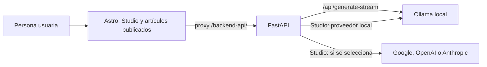

# JullEditor

<p align="center">
  <strong>Estudio editorial y pericial para crear, revisar y preparar artículos técnicos y jurídicos.</strong><br>
  Una interfaz Astro, un backend FastAPI y motores locales con opción de proveedores cloud en el Studio.
</p>

<p align="center">
  <a href="#inicio-local">Inicio local</a> ·
  <a href="#flujo-de-trabajo">Flujo de trabajo</a> ·
  <a href="#elegir-un-motor-de-ia">Motores de IA</a> ·
  <a href="#despliegues">Despliegues</a> ·
  <a href="#marco-editorial-y-jurídico">Marco editorial y jurídico</a> ·
  <a href="#exportar-publicar-e-imprimir">Exportar e imprimir</a> ·
  <a href="#verificación">Verificación</a>
</p>

> [!IMPORTANT]
> **Interfaz principal:** el Estudio Redactor se abre en `/` y también está disponible en `/studio`. Google Gemini, OpenAI, Anthropic y Ollama se pueden seleccionar para sus acciones y chat. Si eliges un proveedor cloud, el texto de la solicitud se envía a ese proveedor; el modo local requiere una instancia Ollama accesible al backend.

> **Recomendación de uso:** el panel está diseñado para computadoras y aprovecha monitores amplios para mostrar edición, configuración y auditoría en paralelo. En pantallas estrechas los paneles se apilan sin ocultar funciones.

## En esta página

| Quiero… | Ir a |
|---|---|
| Instalar y arrancar la aplicación en mi equipo | [Inicio local](#inicio-local) |
| Elegir una fuente, tema y modo de edición | [Flujo de trabajo](#flujo-de-trabajo) |
| Configurar Google, OpenAI, Anthropic u Ollama para Studio | [Elegir un motor de IA](#elegir-un-motor-de-ia) |
| Desplegar en Vercel o con Docker | [Despliegues](#despliegues) |
| Copiar, preparar o imprimir un artículo | [Exportar, publicar e imprimir](#exportar-publicar-e-imprimir) |
| Ejecutar las comprobaciones | [Verificación](#verificación) |
| Consultar el alcance jurídico y sus límites | [Marco editorial y jurídico](#marco-editorial-y-jurídico) |
| Consultar preguntas frecuentes y versión | [FAQ y versionado](#preguntas-frecuentes-y-versionado) |

## Qué incluye

| Área | Función |
|---|---|
| **Studio** (`/`, `/studio`) | Entrada principal de la aplicación: acciones de generación, resumen, transformación y chat editorial; integra las comprobaciones estáticas del catálogo y la taxonomía filtrable. |
| **Artículos publicados** (`/<slug>`) | Las páginas de artículos existentes se mantienen accesibles desde sus URLs. |
| **Backend** | FastAPI ofrece la API, el motor local y las integraciones del Studio. |
| **Contenido** | Corpus local de fuentes venezolanas y técnicas para apoyar el trabajo editorial. |

### Arquitectura



En un despliegue local, `run.py` inicia Astro y FastAPI. En Vercel se despliega Astro; FastAPI y, cuando se usa, Ollama deben ejecutarse en una infraestructura externa accesible.

## Flujo de trabajo

### Studio: redactar, editar o reversionar

1. Abre `/` o `/studio` y selecciona el proveedor local o uno de los proveedores cloud configurados en FastAPI.
2. Elige generación, resumen, transformación o reversionado por URL; también puedes editar el Markdown y continuar en el chat.
3. Revisa el borrador en la vista Revista, Editor Markdown o Vista CMS.
4. Usa las secciones integradas de **Control de calidad** y **Taxonomía** para revisar metadatos estáticos y filtrar los artículos publicados.

El reversionado por URL solo extrae contenido cuando se proporciona una URL. La selección de proveedor y el contenido de la solicitud se envían a FastAPI; si seleccionas un motor cloud, el contenido se envía al proveedor correspondiente.

### Temas y enfoques

El Studio ofrece plantillas de informática forense/TSJ, delitos informáticos, firmas y mensajes de datos, IA/gobernanza y documento en blanco, con perfiles editoriales configurables.

## Inicio local

### Requisitos

| Componente | Requisito |
|---|---|
| Python | 3.10 o superior |
| Node.js | 22 o superior |
| Ollama | Necesario para las funciones locales de generación del Studio |
| npm | Incluido con Node.js; las dependencias de Astro se instalan desde `frontend/` |

### Instalar

Desde la raíz del repositorio, crea un entorno Python e instala las dependencias:

```powershell
python -m venv .venv
.\.venv\Scripts\Activate.ps1
python -m pip install -r requirements.txt

Push-Location frontend
npm ci --include=optional --workspaces=false
Pop-Location
```

Para desarrollo en macOS/Linux, activa el entorno con `source .venv/bin/activate`; ejecuta los comandos npm dentro de `frontend/`.

### Inicio rápido en Windows (sin conocimientos técnicos)

Si estás en Windows y deseas una configuración asistida de 1 clic:
1. Haz doble clic en **`primer paso instalar ia local.bat`**:
   - Detecta e instala Ollama automáticamente (vía winget o instalador oficial silencioso).
   - Inicia el servicio de IA local en segundo plano.
   - Analiza la RAM de tu PC y descarga el modelo **IBM Granite 3.3** adecuado (`granite3.3:8b` si tienes ≥8 GB de RAM o `granite3.3:2b` si tienes menos).
   - Realiza una prueba de ejecución en vivo para confirmar que el modelo está listo.
2. Luego haz doble clic en **`start.bat`** (o `crear_articulo.bat`) para iniciar JullEditor. En el Studio, el motor seleccionado por defecto es **Ollama local (IBM Granite / offline)**.

Si usarás un proveedor local en Linux o macOS, instala y arranca Ollama, y asegúrate de que el modelo seleccionado esté disponible allí. Para configurar modelos cloud, consulta [Elegir un motor de IA](#elegir-un-motor-de-ia).

`python run.py` ejecuta el bootstrap del proyecto, que comprueba las dependencias, Ollama y un modelo recomendado. Si prefieres instalar o descargar un modelo manualmente, sigue las instrucciones de [Ollama](https://ollama.com/download) y ejecuta `ollama pull <modelo>`; configura después `OLLAMA_MODEL` o `GRANITE_MODEL` según corresponda.

### Arrancar

```powershell
python run.py
```

La interfaz web local se abre en `http://127.0.0.1:3000`; FastAPI escucha en `http://127.0.0.1:8000`. Las opciones de línea de comandos incluyen:

| Comando | Uso |
|---|---|
| `python run.py --cli` | Generador interactivo en terminal |
| `python run.py --tui` | Interfaz TUI |
| `python run.py --file ruta\fuente.md` | Inicia el modo CLI con un archivo |
| `python run.py --port 8001` | Cambia el puerto de FastAPI |
| `python run.py --studio-port 3001` | Cambia el puerto de Astro |
| `python run.py --no-bootstrap` | Omite el bootstrap automático |
| `python run.py --test` | Ejecuta la suite de pruebas Python con pytest |

Para operar Astro directamente, ejecuta sus comandos desde `frontend/` (la API FastAPI debe estar levantada por separado):

| Comando | Uso |
|---|---|
| `npm run dev` | Servidor de desarrollo Astro |
| `npm run build` | Build de producción |
| `npm run preview` | Previsualiza el build |

## Elegir un motor de IA

### Qué motor usa cada sección

| Interfaz | Motores disponibles |
|---|---|
| Studio — endpoint principal de generación (`/api/generate-stream`) | Ollama local |
| `/` y `/studio` — acciones y chat (`/api/ai-action`, `/api/ai-chat`) | Google Gemini, OpenAI Chat Completions, Anthropic Messages u Ollama local |

Los adaptadores del Studio usan las APIs oficiales de esos proveedores cloud. No implican compatibilidad cloud para `/api/generate-stream`.

### Configuración del backend

Define las variables en el entorno de **FastAPI**, nunca en el frontend ni en variables `PUBLIC_*` de Astro:

| Variable | Se usa para |
|---|---|
| `GEMINI_API_KEY` | Credencial de Google Gemini |
| `GEMINI_MODEL` | ID de modelo de Gemini |
| `OPENAI_API_KEY` | Credencial de OpenAI |
| `OPENAI_MODEL` | ID de modelo de OpenAI |
| `ANTHROPIC_API_KEY` | Credencial de Anthropic |
| `ANTHROPIC_MODEL` | ID de modelo de Anthropic |
| `OLLAMA_BASE_URL` | URL base de Ollama accesible desde FastAPI |
| `OLLAMA_MODEL` | Modelo local seleccionado por el Studio |

Los proveedores cloud requieren que estén configurados tanto la clave como el modelo correspondiente. Para inferencia local, el Studio usa `OLLAMA_MODEL` y puede recurrir a `GRANITE_MODEL`. Si FastAPI está en otro host o contenedor, `localhost` apunta a ese host/contenedor, no al equipo del navegador.

El frontend envía la selección del proveedor y el contenido de la solicitud, pero no recoge ni guarda claves cloud. Si seleccionas Google, OpenAI o Anthropic, considera que el texto fuente y la conversación se transmiten al proveedor elegido y aplica sus condiciones de privacidad.

## Despliegues

### Vercel

Vercel aloja el frontend Astro y su proxy; **no aloja este backend FastAPI ni Ollama**. Configura un backend remoto accesible por HTTPS antes de habilitar las funciones de IA del Studio en producción.

1. En Vercel, establece **Root Directory** en `frontend`.
2. Usa el framework **Astro**, el comando de instalación `npm ci --include=optional --workspaces=false` y el comando de build `npm run build`.
3. No configures un directorio de salida personalizado.
4. Define estas variables en **Project Settings → Environment Variables**:

| Variable | Dónde se usa | Valor |
|---|---|---|
| `PUBLIC_SITE_URL` | Build de Astro | URL pública del sitio |
| `BACKEND_API_URL` | Proxy server-side `/backend-api/` | URL HTTPS base de FastAPI, sin barra final |

Configura ambas variables en los entornos Preview y Production que correspondan. Si falta `BACKEND_API_URL`, el proxy responde `503`. No uses `localhost` como URL de FastAPI en Vercel.

Las claves `GEMINI_API_KEY`, `OPENAI_API_KEY` y `ANTHROPIC_API_KEY` van **solo en el entorno del host FastAPI**. FastAPI y Ollama deben poder comunicarse entre sí cuando se seleccione el motor local. El publicador guarda artículos en el disco del backend: usa almacenamiento persistente en ese host; el filesystem de Vercel no debe tratarse como almacenamiento duradero.

### Docker Compose

El compose incluido inicia Ollama, la aplicación Astro/FastAPI y Nginx. Desde la raíz:

```powershell
docker compose -f docker/docker-compose.yml up --build
```

Nginx publica el sitio por el puerto 80; Compose también mapea los puertos 3000, 8000 y 11434. En un host expuesto a Internet, limita mediante firewall el acceso directo a FastAPI y Ollama y publica el sitio a través de un proxy HTTPS. Docker instala las dependencias del backend desde `requirements-cloud.txt`; `requirements.txt` corresponde al entorno local completo.

### Oracle Cloud con Docker

En una VM Linux con Docker Compose instalado, clona el repositorio en `/opt/granite-blog` (la ruta que espera el archivo systemd incluido) y arranca los servicios:

```bash
sudo git clone https://github.com/julljoll/JullEditor.git /opt/granite-blog
cd /opt/granite-blog
sudo docker compose -f docker/docker-compose.yml up --build -d
```

Opcionalmente, habilita la unidad systemd que inicia Compose al arrancar la VM:

```bash
sudo cp deploy/oracle/granite-blog.service /etc/systemd/system/
sudo systemctl daemon-reload
sudo systemctl enable --now granite-blog.service
```

Antes de exponer el servicio, configura TLS y reglas de red en la VM y restringe los puertos de backend/modelo. Los artículos guardados deben estar en almacenamiento persistente del host.

### Google Colab

El repositorio conserva [`notebooks/granite_blog_colab.ipynb`](notebooks/granite_blog_colab.ipynb) como referencia experimental para iniciar Ollama y FastAPI en Colab. **No es una ruta de despliegue lista para usar**: el notebook aún contiene una URL de clonación de ejemplo y referencia `requirements-colab.txt`, que no existe en el repositorio. Además, levanta FastAPI, no el frontend Astro. Para una interfaz web integrada y mantenida, usa Vercel o el compose de Docker.

## Exportar, publicar e imprimir

| Acción | Dónde | Resultado |
|---|---|---|
| Copiar Markdown Astro | Studio (`/` o `/studio`) | Markdown con metadatos editoriales |
| Copiar HTML CMS | Studio (`/` o `/studio`) | HTML para copiar y revisar en el CMS |
| Descargar `.md` | Studio (`/` o `/studio`) | Archivo Markdown del borrador |
| Imprimir artículo | Página del artículo | Abre el diálogo de impresión del navegador; desde ahí se puede elegir una impresora o guardar como PDF |

Las antiguas páginas independientes `/writer`, `/qa`, `/tags` y `/tags/[tag]` ya no se publican. Las comprobaciones de catálogo y el filtro temático están integrados en el Studio; las páginas publicadas de artículos conservan sus rutas.

La pestaña **Vista CMS** del Studio se describe en la interfaz como simulación Gutenberg/Sitejet; no es una integración oficial ni garantiza una renderización idéntica en esos servicios.

| Atajo | Comportamiento |
|---|---|
| `Enter` en el campo del chat del Studio | Envía el mensaje al proveedor seleccionado. |
| `Ctrl+P` (Windows/Linux) o `Cmd+P` (macOS) | Atajo estándar del navegador para abrir el diálogo de impresión; también está disponible el botón **Imprimir Formato Oficio** en la página del artículo. |

No hay otros atajos globales propios de la aplicación documentados actualmente.

## Marco editorial y jurídico

JullEditor está orientado a la producción editorial sobre informática forense, ciberseguridad, LegalTech y derecho venezolano. El repositorio incluye materiales locales sobre, entre otros:

- Constitución de la República Bolivariana de Venezuela.
- Ley Especial contra los Delitos Informáticos.
- Ley sobre Mensajes de Datos y Firmas Electrónicas.
- Ley de Infogobierno, Manual Único de Cadena de Custodia de Evidencias (2017), materiales de CENIF, normativas SUSCERTE y documentos de jurisprudencia del TSJ.
- Referencias técnicas como ISO/IEC 27037, ISO/IEC 27042, RFC 3227 y NIST SP 800-86.

El enfoque jurídico principal es Venezuela. La cobertura depende de las fuentes disponibles en el corpus y del flujo utilizado; la presencia de una fuente no sustituye la comprobación de su vigencia y aplicabilidad. El contenido generado es un borrador de apoyo: verifica las citas y el análisis antes de publicarlo o utilizarlo profesionalmente. El uso de un proveedor cloud también cambia dónde se procesa el texto fuente.

## Preguntas frecuentes y versionado

<details>
<summary><strong>¿Se puede trabajar sin conexión?</strong></summary>
El flujo de generación con Ollama puede trabajar con fuentes locales sin enviar el prompt a un proveedor cloud. La instalación, la descarga de modelos, la extracción de una URL y el uso de proveedores cloud sí requieren conexión; la interfaz Astro también necesita ejecutarse junto a FastAPI.
</details>

<details>
<summary><strong>¿Las claves de API se guardan en el navegador?</strong></summary>
No. El Studio no presenta un formulario de claves ni incluye credenciales en las solicitudes desde el frontend. Configúralas en el entorno privado de FastAPI. No pegues claves en el chat, el artículo ni los campos de texto.
</details>

<details>
<summary><strong>¿Las verificaciones de Control de calidad son pruebas de runtime?</strong></summary>
No. Son comprobaciones estáticas sobre metadatos y descriptores de la colección durante el build; no ejercitan el backend, los proveedores de IA ni el comportamiento de ejecución.
</details>

<details>
<summary><strong>¿Qué pasa después de “Preparar para Astro”?</strong></summary>
El artículo se valida y copia a la colección de contenido. Ejecuta nuevamente `npm run build` en `frontend/` para regenerar las rutas prerenderizadas del sitio.
</details>

<details>
<summary><strong>¿El contenido generado constituye una opinión jurídica?</strong></summary>
No. Es un borrador asistido por IA. La persona responsable debe revisar fuentes, vigencia normativa, citas, interpretación y atribución antes de publicarlo o utilizarlo en una actuación profesional.
</details>

Para comprobar la API local, abre `http://127.0.0.1:8000/api/health`; la documentación interactiva de FastAPI está en `http://127.0.0.1:8000/docs`.

La versión de código se define en [`backend/version.py`](backend/version.py). El historial de cambios está en [`CHANGELOG.md`](CHANGELOG.md), y las versiones publicadas deben contrastarse con las etiquetas y releases de GitHub. El proyecto sigue [Semantic Versioning](https://semver.org/lang/es/): PATCH para correcciones compatibles, MINOR para funciones compatibles y MAJOR para cambios incompatibles.

## Verificación

### Frontend

Desde `frontend/`:

```powershell
npm run build
npx tsc --noEmit -p tsconfig.json
```

No hay un script `lint` definido en `frontend/package.json`; el chequeo TypeScript se ejecuta con el segundo comando.

### Backend

Con las dependencias de `requirements.txt` instaladas, agrega pytest al entorno de desarrollo y ejecuta desde la raíz:

```powershell
python -m pip install pytest
python -m pytest tests/test_providers.py tests/test_studio_ai.py
python run.py --test
```

Las pruebas de proveedor usan mocks; no requieren credenciales reales ni llamadas a Internet.

## Estructura del repositorio

| Ruta | Contenido |
|---|---|
| `backend/app.py` | FastAPI, endpoint principal de generación, publicación y healthcheck |
| `backend/studio_ai.py` | Acciones y chat del Studio |
| `backend/providers.py` | Contrato/adaptadores de Google, OpenAI, Anthropic y Ollama para Studio |
| `backend/` | Otros módulos de generación, corpus/RAG, validaciones y exportación |
| `frontend/src/pages/` | Studio, páginas de artículos publicados y proxy `/backend-api/` |
| `frontend/src/content/blog/` | Colección de artículos Astro |
| `Informacion_docling_rag/` | Fuentes jurídicas y técnicas locales |
| `tests/` | Pruebas Python |
| `docker/` | Dockerfile, Compose y configuración de Nginx |
| `notebooks/` | Notebook experimental de Colab |
| `deploy/oracle/` | Unidad systemd para iniciar Docker Compose en una VM Linux de Oracle Cloud |
| `requirements.txt` | Dependencias Python para desarrollo local |
| `requirements-cloud.txt` | Dependencias Python necesarias para Docker |
| `.env.example` | Plantilla de variables de entorno |

## Enlaces útiles

- [Astro](https://astro.build/)
- [FastAPI](https://fastapi.tiangolo.com/)
- [Ollama](https://ollama.com/)
- [API de Gemini](https://ai.google.dev/api/generate-content)
- [API de OpenAI Chat Completions](https://platform.openai.com/docs/api-reference/chat/create)
- [API de Anthropic Messages](https://docs.anthropic.com/en/api/messages)
- [Semantic Versioning](https://semver.org/lang/es/)
