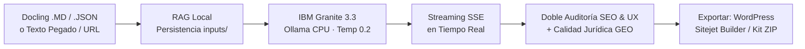

# ⚖️ Granite Blog Writer & LegalTech Studio

<p align="center">
  <strong>Estación Editorial y Pericial de Redacción de Artículos de Blog con IBM Granite Local (CPU-Only)</strong><br>
  <em>Optimizada para Ciberseguridad, Inteligencia Artificial, Ciencia de Datos, Derecho Digital y Jurisdicciones de Venezuela 🇻🇪 y Colombia 🇨🇴.</em>
</p>

<p align="center">
  
  
  
  
  
  
</p>

---

## 💡 ¿Qué es este Proyecto?

**Granite Blog Writer & LegalTech Studio** es una estación editorial local de alta precisión que transforma documentos técnicos, investigaciones forenses, peritajes o enlaces web en **artículos de blog de alto impacto editorial, rigor normativo y posicionamiento SEO / GEO 2026**.

### 🌟 Pilares Fundamentales:
1. **100% Offline y Privado (0ms Latencia de Red):** Procesa todo en la CPU de tu equipo con **IBM Granite 3.3** vía **Ollama**. Cero envío de datos a la nube o APIs de pago.
2. **Cero Alucinación Jurídica (Temperatura 0.2):** Motor RAG local que fundamenta los textos exclusivamente en la **normativa real** autorizada (CRBV, Delitos Informáticos, Mensajes de Datos para Venezuela 🇻🇪; Constitución 1991, Ley 1273, Ley 1581 para Colombia 🇨🇴).
3. **Auditoría Dual SEO & UX 2026 en Tiempo Real:**
   - **Calidad SEO Estructural (0-100%):** H1 óptimo (8-12 palabras), Meta descripción (145-160 caracteres), H2/H3 (5-9 palabras), TOC con anclas, FAQ, autor E-E-A-T y doble bloque Schema.org (`TechArticle` + `FAQPage`).
   - **Calidad Jurídica & GEO 2026 (0-100%):** Respuesta directa *"Answer-First"* (40 a 60 palabras) para citación en Google AI Overviews y Perplexity, descargo ético obligatorio, detección de ≥ 8 términos jurídicos autorizados y ≥ 50% de H2 formulados como preguntas.
4. **Perfiles de Voz Especializados (VE / CO):** Tonos periciales auténticos para Abogados Doctrinales, Litigantes y Explicativos con fórmulas procesales y control anti-promesas.
5. **Exportación Universal Multi-CMS:**
   - 📋 **Copiar p/ WordPress:** HTML enriquecido con estilos Gutenberg y soporte para Classic Editor.
   - 🚀 **Copiar p/ Sitejet Builder:** HTML visualmente limpio, sin scripts, con fallback de 5 etapas en portapapeles.
   - 📦 **Descargar Kit Sitejet:** Empaquetado `.zip` con `contenido.html`, `articulo.md`, `metadata.json` y `banner.png` (renderizado local de SVG a PNG).

---

## 🔄 Flujo de Trabajo



---

## 💻 Requisitos del Sistema

| Componente | Requisito Recomendado | Requisito Mínimo |
|---|---|---|
| **Sistema Operativo** | Windows 10 / 11 (64-bit) | Windows 10 |
| **Memoria RAM** | 16 GB (para `granite3.3:8b`) | 8 GB (usando `granite3.3:2b`) |
| **Procesador (CPU)** | Intel Core i5/i7/Ryzen 5 o superior | 4 núcleos x64 |
| **Almacenamiento** | ~6 GB libres (modelo + entorno) | ~3 GB libres |
| **Python** | Python 3.10, 3.11, 3.12 o 3.14 | Python 3.10 |
| **Ollama** | Última versión instalada | v0.3.0+ |

---

## 🚀 Guía de Instalación Rápida (Paso a Paso)

### Paso 1: Instalar Ollama en Windows
Descárgalo e instálalo desde [ollama.com/download/windows](https://ollama.com/download/windows) o ejecuta en PowerShell:
```powershell
winget install Ollama.Ollama
```

### Paso 2: Descargar el Modelo IBM Granite
Abre una terminal y descarga el modelo optimizado para CPU:
```powershell
ollama pull granite3.3:8b
```
*(Opcional: Si tu equipo tiene 8 GB de RAM o deseas máxima velocidad en CPU livianas, descarga `ollama pull granite3.3:2b`)*.

### Paso 3: Instalar Dependencias de Python
En la carpeta del proyecto, ejecuta:
```powershell
pip install -r requirements.txt
```

### Paso 4: Iniciar la Aplicación
Haz doble clic en el archivo **`start.bat`** (o ejecuta `.\start.ps1` en PowerShell):
```powershell
.\start.bat
```
El script comprobará el entorno, verificará Ollama, iniciará el servidor FastAPI y abrirá automáticamente tu navegador en:
👉 **[http://127.0.0.1:8000](http://127.0.0.1:8000)**

---

## 🖥️ Manual de Uso de la Interfaz (UX/UI en 3 Columnas)

La interfaz sigue el estándar pericial **USWDS Cyber-Legal Light Mode** (alto contraste WCAG AAA) organizada en tres columnas de trabajo:

```
┌─────────────────────────┬───────────────────────────────┬─────────────────────────┐
│ 1. PANEL DE CONTROL     │ 2. VISOR DEL ARTÍCULO         │ 3. AUDITORÍA SEO & UX   │
│                         │                               │                         │
│ • Modo de Ingesta       │ • Cabecera 16:9 Procedural    │ • Score SEO Estructural │
│ • Especialidad Temática │ • Formato SEO Blog PDF        │ • Score Calidad Jurídica│
│ • Perfil de Voz (VE/CO) │ • Callouts y Resúmenes        │ • Badge Índice YMYL 2026│
│ • Objetivo de Palabras  │ • Doble Schema.org JSON-LD    │ • Respuesta Directa GEO │
│ • Slider Anti-Alucinante│ • Copiar WordPress / Sitejet  │ • Descargo y Léxico     │
│ • Botón 'Redactar'      │ • Descargar Kit Sitejet ZIP   │ • Auditoría Profunda    │
└─────────────────────────┴───────────────────────────────┴─────────────────────────┘
```

### 1️⃣ Columna Izquierda: Panel de Control e Ingesta
- **Pestañas de Ingesta:**
  - **Docling (.MD / JSON):** Arrastra uno o varios archivos procesados por Docling. Limpia artefactos OCR y persiste inmutablemente en `RAG/inputs/`.
  - **Pegar Texto:** Escribe o pega borradores, notas periciales o fuentes.
  - **URL Externa:** Extrae el contenido y metadatos de cualquier artículo web con validación anti-SSRF.
- **Especialidad Temática:**
  - `Derecho Digital` (*Predeterminado*): Decreto-Ley de Mensajes de Datos, Firmas Electrónicas, validez probatoria digital y TSJ.
  - `Ciberseguridad`: Delitos informáticos, cadena de custodia forense, VenCERT e ISO/IEC 27037.
  - `IA & Datos`: Modelos generativos, soberanía de datos, gobernanza digital y LOCTI.
  - `Ciencia & Tech`: Telecomunicaciones, nube e infraestructura nacional.
- **Perfil de Voz / Tono:**
  - ⚖️ **Abogado Venezuela:** Doctrinal (Forense / TSJ · *Recomendado*), Litigante (Ruta procesal / Lapsos), Explicativo (Divulgación), Jull (Técnico-Científico) y Jull (Explicativo).
  - ⚖️ **Abogado Colombia:** Doctrinal (Precedente / Corte Constitucional), Litigante (Acción de Tutela / Términos), Explicativo (Habeas Data / Ciudadano).
  - 🌐 **Corporativo y General:** Consultor Corporativo (Compliance / Riesgos), Conversacional, Analítico, Didáctico, Ejecutivo.
- **Objetivo de Extensión:** `Pilar SEO (~1000 pal. · Recomendado 2026)`, 600, 1500 o 2000 palabras.
- **Jurisdicción:** Auto-detección inteligente, Venezuela (`es-VE`), Colombia (`es-CO`) o Internacional (`ISO/NIST/UE`).
- **Temperatura (Rigor Factual):** Predeterminada en `0.2` para garantizar precisión milimétrica y cero invención de leyes.

### 2️⃣ Columna Central: Editor y Visor Estructurado
- **Streaming SSE en Tiempo Real:** Redacción fluida en vivo con cursor interactivo y contador de tokens/tiempo.
- **Cajas Didácticas y Estilos Inline:** *Meta Descripción*, *Resumen Ejecutivo en 30 Segundos*, *En Palabras Simples* y *Conclusión del Párrafo*.
- **Acciones y Exportación Multi-CMS:**
  - 📋 **Copiar p/ WordPress:** Copia el artículo en HTML estilizado compatible con bloques de Gutenberg o Editor Clásico.
  - 🚀 **Copiar p/ Sitejet:** Copia HTML higienizado sin etiquetas `<script>` para el constructor visual de Sitejet.
  - 📦 **Kit Sitejet:** Descarga un archivo `.zip` con el artículo en Markdown, HTML, metadatos JSON y la cabecera procesada a PNG.
  - 📥 **Descargar .MD / .HTML / Imprimir Oficio:** Formatos completos con Frontmatter YAML y estilos periciales.

### 3️⃣ Columna Derecha: Auditoría SEO & UX (Doble Scorecard 2026)
- **Score Calidad SEO Estructural (0-100%):** Evalúa longitud H1 (8-12 palabras), meta descripción (145-160 caracteres), subtítulos H2 rítmicos, negritas, enlaces, FAQ, TOC y microdatos Schema.org.
- **Score Calidad Jurídica & GEO 2026 (0-100%):**
  - **Respuesta Directa GEO (40-60 palabras):** Párrafo inicial extractable por Google AI Overviews, Perplexity y ChatGPT.
  - **Descargo Ético Obligatorio:** Cláusula de advertencia profesional (*"no constituye asesoría legal..."*).
  - **Términos Jurídicos Detectados:** Contador de términos autorizados del glosario procesal (óptimo ≥ 8).
  - **H2 como Preguntas (≥ 50%):** Redacción en formato de consulta de usuario.
  - **Control Anti-Promesas y Anti-Calcos:** Sanciona expresiones engañosas (*"garantizamos el éxito"*) y vicios lingüísticos (*"a nivel de"*).
- **Índice YMYL 2026 Consolidado:** Medidor ponderado (*60% SEO Estructural + 40% Calidad Jurídica*) con badge de estado (`EXCELENTE 2026`, `ACEPTABLE`, `REVISIÓN REQUERIDA`).
- **Botón Auditoría Profunda (`btnDeepAudit`):** Ejecuta la evaluación determinista contra el backend `/api/seo-audit` y despliega chips detallados con advertencias e incidencias.

---

## ⌨️ Atajos de Teclado (Power Users)

| Atajo | Acción |
|---|---|
| <kbd>Ctrl</kbd> + <kbd>Enter</kbd> | **Redactar / Iniciar Inferencia** |
| <kbd>Escape</kbd> | **Detener Inferencia Inmediatamente** |
| <kbd>Ctrl</kbd> + <kbd>Shift</kbd> + <kbd>C</kbd> | **Copiar con Estilos para WordPress** |
| <kbd>Ctrl</kbd> + <kbd>Shift</kbd> + <kbd>S</kbd> | **Copiar para Sitejet Builder** |
| <kbd>Ctrl</kbd> + <kbd>Shift</kbd> + <kbd>M</kbd> | **Copiar Markdown Crudo** |
| <kbd>Ctrl</kbd> + <kbd>Shift</kbd> + <kbd>P</kbd> | **Imprimir en Formato Pericial** |
| <kbd>?</kbd> | **Abrir Modal de Ayuda de Atajos** |

---

## 🎯 Especialidades Temáticas y Marco Jurídico

```text
🇻🇪 VENEZUELA:
   • Constitución de la República Bolivariana de Venezuela (CRBV, Arts. 28, 60 y 110)
   • Decreto-Ley sobre Mensajes de Datos y Firmas Electrónicas (G.O. 37.148)
   • Ley Especial contra los Delitos Informáticos (G.O. 37.313)
   • Ley de Infogobierno (G.O. 40.274) y Ley Orgánica de Ciencia y Tecnología (LOCTI)
   • Cadena de Custodia Digital (COPP Art. 187 / MP / CICPC / SUSCERTE / VenCERT)

🇨🇴 COLOMBIA:
   • Constitución Política de Colombia de 1991 (Arts. 15 y 20)
   • Ley 1273 de 2009 (Protección de la Información y de los Datos / Delitos Informáticos)
   • Ley 1581 de 2012 y Ley 1266 de 2008 (Habeas Data y Datos Personales)
   • Ley 527 de 1999 (Mensajes de Datos, Comercio Electrónico y Firmas Digitales)
   • Código General del Proceso (CGP) · Precedentes Corte Constitucional · Circulares SIC

🌐 INTERNACIONAL:
   • Normas ISO/IEC 27001, 27037 (Evidencia Digital) · Estándares NIST SP 800-86 · RFC 3227
```

---

## 📂 Estructura Limpia del Proyecto

```text
├── backend/                  # Servidor FastAPI y motores de inferencia
│   ├── app.py                # Endpoints FastAPI, CORS y SSE streaming
│   ├── prompts.py            # Motor de prompts, wireframe SEO y reglas GEO 2026
│   ├── legal_profiles.py     # Perfiles de voz VE/CO, glosarios y fórmulas procesales
│   ├── legal_validator.py    # Validador de calidad jurídica, calcos, ética y GEO
│   ├── seo_validator.py      # Validador determinista de métricas SEO y Schema.org
│   ├── rag_manager.py        # Gestor de RAG, persistencia e historial inmutable
│   ├── docling_parser.py     # Parser de archivos Markdown/JSON de Docling
│   ├── scraper.py            # Extractor web seguro con HTTPX y BeautifulSoup
│   ├── image_generator.py    # Generador procedural de cabeceras SVG 16:9
│   ├── logger_config.py      # Logger con rotación automática a logs/app.log
│   └── data/
│       └── legal_corpus_ve.json # Corpus normativo venezolano indexado
├── frontend/                 # Interfaz web modular ES6
│   ├── index.html            # Layout semántico en 3 columnas
│   ├── sitejet-lab.html      # Laboratorio de calibración visual Sitejet Builder
│   ├── favicon.svg           # Ícono SVG pericial
│   ├── manifest.json         # Manifest PWA
│   ├── css/
│   │   ├── style.css         # Tokens de diseño USWDS Cyber-Legal Light Mode
│   │   └── bootstrap.min.css # Framework base local
│   └── js/
│       ├── app.js            # Orquestador ES6 y sincronización de estado
│       └── modules/          # Módulos JS especializados
│           ├── seo-audit.js          # Auditoría client-side y deep audit server-side
│           ├── sitejet-exporter.js   # Exportador Sitejet con fallback multietapa y ZIP
│           ├── wordpress-exporter.js # Exportador Gutenberg enriquecido
│           ├── article-generator.js  # Gestor SSE streaming y payload
│           ├── docling-handler.js    # Manejador de subida y limpieza Docling
│           ├── scraper-handler.js    # Consumo de endpoint de scraping
│           ├── markdown-renderer.js  # Renderizado seguro de Markdown y tablas
│           ├── article-history.js    # Historial de artículos archivados en RAG
│           ├── health-check.js       # Verificación en vivo de Ollama y Granite
│           ├── keyboard-shortcuts.js # Atajos de teclado accesibles
│           └── toast-notifications.js# Notificaciones contextuales accesibles
├── RAG/                      # Memoria viva del sistema
│   ├── inputs/               # Fuentes importadas persistidas
│   └── articulos/            # Artículos terminados con Frontmatter YAML
├── Informacion_docling_rag/  # Documentos normativos indexables para RAG
├── tests/                    # Suite de 35 pruebas automatizadas (pytest)
│   ├── test_api_endpoints.py # Verificación de API, SSRF, Sitejet y auditoría SEO
│   ├── test_legal_profiles.py# Validación de perfiles de voz VE/CO y glosarios
│   ├── test_prompts.py       # Pruebas de estructura de prompts y reglas GEO 2026
│   ├── test_docling_parser.py# Pruebas de limpieza y extracción Docling
│   └── test_rag_manager.py   # Pruebas de persistencia y contexto normativo
├── logs/                     # Registro de ejecución con rotación
├── requirements.txt          # Dependencias Python
├── start.bat                 # Lanzador de 1 clic para Windows
└── start.ps1                 # Script automatizado de inicio PowerShell
```

---

## 🧪 Laboratorio de Compatibilidad Sitejet Builder

Para validar que los artículos generados se visualicen de forma idéntica en el editor de **Sitejet Builder**, el proyecto incluye un entorno de calibración:
* Abre en tu navegador: **`http://127.0.0.1:8000/sitejet-lab.html`**
* Te permite probar:
  - Preservación de cajas destacadas (*Callouts* de resumen, notas y avisos).
  - Tablas estilizadas con tipografía legible y celdas acolchadas.
  - Títulos H1 a H3 con jerarquía visual proporcionada.
  - Botones de prueba de copiado directo y descarga de kits empaquetados.

---

## ❓ Preguntas Frecuentes (FAQ)

<details>
<summary><strong>¿Puedo usarlo totalmente sin conexión a internet?</strong></summary>
<strong>Sí, al 100%.</strong> El modelo IBM Granite corre localmente en tu procesador a través de Ollama. Si utilizas la pestaña <em>Docling (.MD/JSON)</em> o <em>Pegar Texto</em>, no se realiza ninguna petición externa a internet.
</details>

<details>
<summary><strong>¿Qué diferencia hay entre "Copiar p/ WordPress" y "Copiar p/ Sitejet"?</strong></summary>
<strong>WordPress (Gutenberg)</strong> procesa bloques enriquecidos con clases e inline styles específicos para su parser de bloques. <strong>Sitejet Builder</strong> es un constructor visual estricto que rechaza scripts y requiere estilos inline directos en etiquetas HTML estándar (sin clases complejas) para evitar que su editor sanitice o rompa la diagramación.
</details>

<details>
<summary><strong>¿Cómo funciona el Kit Sitejet (.zip)?</strong></summary>
Al pulsar <strong>"Kit Sitejet"</strong>, tu navegador convierte en milisegundos la cabecera SVG a un PNG real de alta resolución (`1200x675 px`) y genera un archivo ZIP descargable que contiene el HTML limpio, el Markdown original, los metadatos estructurados en JSON y la imagen lista para subir como recurso a Sitejet.
</details>

<details>
<summary><strong>¿Por qué la temperatura está configurada en 0.2?</strong></summary>
En la redacción jurídica y técnica (YMYL), temperaturas altas (> 0.5) provocan que los modelos de lenguaje alucinen normativas, inventen números de artículos o citen jurisprudencia ficticia. Con <strong>0.2 (Rigor Factual)</strong>, IBM Granite se ciñe estrictamente a los hechos de la fuente y al corpus legal autorizado.
</details>

<details>
<summary><strong>¿Cómo ejecuto las pruebas automatizadas del proyecto?</strong></summary>
Abre PowerShell y ejecuta:
<pre><code>py -3.14 -m pytest -v</code></pre>
La suite incluye <strong>35 pruebas automatizadas</strong> que verifican endpoints de FastAPI, rechazo anti-SSRF, parseo de Docling, perfiles jurídicos de Venezuela y Colombia, validadores de auditoría SEO/GEO y generación de kits.
</details>

---

<p align="center">
  <strong>Desarrollado con arquitectura Cyber-Legal Blueprint · Cumplimiento de estándares periciales, SEO / GEO 2026 y accesibilidad WCAG 2.1 AAA</strong>
</p>
