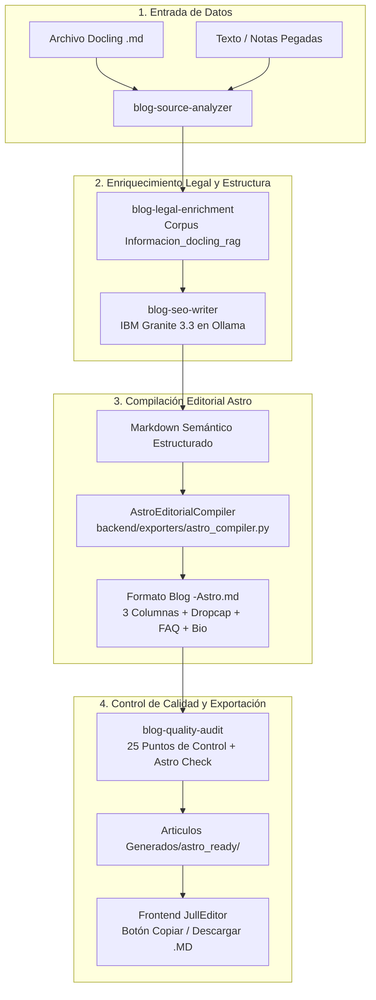

# PLAN MAESTRO: CONVERSIÓN DE JULLEDITOR EN GENERADOR DE ARTÍCULOS EDITORIALES PARA EL FRAMEWORK ASTRO (v4.0.0)

> **Estado:** COMPLETADO AL 100% · EN PRODUCCIÓN
> **Arquitectura:** Offline-First · Python 3.12 (FastAPI) · IBM Granite 3.3 & Ollama · Astro Framework (Content Collections) · USWDS Design System
> **Lanzador Canónico:** `ejecutar_local.bat` (Instalación automática y arranque en 1 solo clic)
> **Destino:** `frontend/src/content/blog/{slug}.md` y persistencia dual en `Articulos Generados/` (.md y .html)
> **Documento Base:** `Formato Blog -Astro.md` + `.agents/AGENTS.md` + `.agents/plans/PLAN_MAESTRO_v4.md`  

---

## 1. VISIÓN EJECUTIVA Y ANÁLISIS DE ARQUITECTURA

### 1.1 El Reto

JullEditor nació con un enfoque centrado en la exportación a WordPress (Gutenberg) y documentos HTML5 estáticos. El usuario requiere transformar la salida del sistema para que genere **artículos Markdown (`.md`) listos para ser copiados y pegados en el framework Astro**, cumpliendo estrictamente con la sofisticada estética editorial descrita en `Formato Blog -Astro.md`:

- Maquetación de periódico de gran tirada en **3 columnas responsivas** (`editorial-three-columns`, `editorial-col`).
- Elementos tipográficos de prensa clásica: **Letra Capitular (Dropcap)** (`editorial-dropcap`), **Cita Destacada (Pull Quote)** (`editorial-quote`), **Entradilla de Impacto (Lead)** (`editorial-lead`) y **Cajas de Advertencia** (`editorial-box`).
- Bloques de **FAQ en cuadrícula USWDS** (`grid-row`, `tablet:grid-col-6`) para Google *People Also Ask* (PAA).
- Caja de autor **E-E-A-T** con credenciales periciales y forenses acreditadas.
- **Frontmatter YAML canónico** tipado para colecciones de contenido de Astro (`title`, `description`, `pubDate`, `author`, `tags`, `category`, `heroImage`, `seoKeyword`, `readingTime`, `featured`, `draft`).
- **Sin encabezado `# H1` en el cuerpo**, ya que el layout de Astro lo genera automáticamente desde el frontmatter.

### 1.2 Principio Arquitectónico Senior: "Generación Semántica IA + Compilación Editorial Determinista"
>
> [!IMPORTANT]
> **¿Por qué NO pedirle a un SLM local (IBM Granite 3.3 de 2B/8B) que redacte directamente 300 líneas de HTML anidado complejo?**  
> Forzar a un modelo de lenguaje pequeño/mediano a generar directamente decenas de etiquetas `<div>`, clases CSS, grid USWDS y dropcaps mientras mantiene la coherencia pericial y legal produce:
>
> 1. Etiquetas HTML sin cerrar o mal anidadas que rompen el compilador Vite/MDX de Astro.
> 2. Sangrías de 4 espacios involuntarias tras líneas en blanco que Markdown interpreta como bloques de código literal.
> 3. Alucinaciones en clases CSS o pérdida de la densidad de palabras clave.

**La Solución de Nivel Senior:**  

1. **IBM Granite 3.3** genera un artículo en **Markdown Semántico Estructurado** de altísima pureza: Answer-First, subtítulos H2 con preguntas SEO, párrafos rítmicos de 45-65 palabras, citas destacadas, cajas de lección pericial, checklist accionable, marco legal venezolano estricto y FAQ con 3 preguntas.
2. Un **Compilador Editorial Astro (`AstroEditorialCompiler`)** en Python toma el Markdown semántico de Granite y lo ensambla de forma determinista y 100% matemática en la estructura HTML/CSS exacta de `Formato Blog -Astro.md`:
   - Envuelve el lead en `<div class="editorial-lead">`.
   - Extrae o construye la cita destacada en `<div class="editorial-quote">`.
   - Distribuye las secciones H2 en bloques `<div class="editorial-col">` dentro de `<div class="editorial-three-columns">`.
   - Inyecta automáticamente la letra capitular `<span class="editorial-dropcap">X</span>` en la primera letra del desarrollo.
   - Envuelve las cajas de lección y checklist en `<div class="editorial-box">`.
   - Transforma las preguntas frecuentes en el grid USWDS `<div class="grid-row grid-gap-2">`.
   - Añade el bloque E-E-A-T de autor institucional y los metadatos YAML perfectos.
   - Elimina cualquier `# H1` residual en el cuerpo para no duplicar el título del layout de Astro.
   - Sanitiza mojibake y encapsula Schema.org en comentarios HTML seguros.

---

## 2. EVALUACIÓN Y MEJORAS AL FORMATO (`Formato Blog -Astro.md`)

Como arquitecto sénior, se han identificado las siguientes mejoras al formato original para elevar su calidad técnica y SEO a nivel mundial:

### 2.1 Mejoras al Frontmatter YAML

| Campo Original | Diagnóstico | Mejora Senior |
| :--- | :--- | :--- |
| `heroImage: "../../assets/blog-placeholder-1.jpg"` | Rígido si el usuario usa Astro v4/v5 con la carpeta `src/assets/` o `public/images/`. | Soportar ruta relativa y generar un fallback inteligente al slug del artículo: `heroImage: "../../assets/blog/{slug}.jpg"`. |
| `tags: [...]` | A menudo se escriben con mayúsculas o espacios. | Normalizar automáticamente a minúsculas, sin acentos y con guiones (`ciberseguridad-forense`). |
| `description` | Si supera los 160 caracteres, Google trunca con `...`. | Truncado inteligente a nivel de palabra completa entre 145 y 158 caracteres. |
| `category` | Texto libre sin mapeo de temas. | Mapeo bidireccional entre los temas del catálogo (`cybersecurity` → `"Opinión Pericial"` / `"Investigación"`). |

### 2.2 Esquema Zod Recomendado para Astro (`src/content/config.ts`)

Para que el usuario pueda copiar y pegar este esquema directamente en su proyecto Astro:

```typescript
// src/content/config.ts
import { defineCollection, z } from 'astro:content';

const blog = defineCollection({
  type: 'content',
  schema: ({ image }) => z.object({
    title: z.string().max(70, "El título SEO no debe exceder 70 caracteres"),
    description: z.string().min(100).max(165),
    pubDate: z.coerce.date(),
    updatedDate: z.coerce.date().optional(),
    author: z.string().default("Equipo Pericial sha256.us"),
    tags: z.array(z.string()).min(1).max(8),
    category: z.enum([
      "Opinión Pericial",
      "Investigación",
      "Guía Técnica",
      "LegalTech",
      "Normativas",
      "Ciberseguridad",
      "Forense Digital"
    ]).default("Opinión Pericial"),
    heroImage: z.string().optional(),
    seoKeyword: z.string(),
    readingTime: z.number().int().positive().default(5),
    featured: z.boolean().default(false),
    draft: z.boolean().default(false),
  }),
});

export const collections = { blog };
```

### 2.3 Paquete de Estilos CSS Editorial (`editorial-newspaper.css`)

Se entregará el CSS completo para incluir en el layout de Astro (`<style is:global>` o import en `Layout.astro`):

- Soporte para `.editorial-container`, `.editorial-lead`, `.editorial-quote`.
- Flex/Grid para `.editorial-three-columns` con degradación elegante a 2 columnas en tablet y 1 columna en móvil (`break-inside: avoid`).
- Estilos para `.editorial-dropcap` con fuentes serif de prensa (Georgia, Playfair, Merriweather).
- Clases USWDS livianas (`grid-row`, `tablet:grid-col-6`, `radius-md`, `border-left-05`) para el bloque de FAQ sin requerir toda la librería pesada de USWDS.

---

## 3. ARQUITECTURA DE INTEGRACIÓN CON LA CARPETA `.agents/`

El plan articula armónicamente las reglas y habilidades de `.agents/`:



1. **`AGENTS.md`**: Se respeta al 100% el modo offline-first, prioridad a Docling Markdown, cero alucinaciones de leyes y persistencia automática en `Articulos Generados/`.
2. **`blog-seo-writer`**: Se expande para incluir la directiva de salida del nuevo modo editorial Astro, manteniendo párrafos de 45-65 palabras, palabras clave en negrita y conclusión de párrafo.
3. **`blog-quality-audit`**: Se actualiza el script `audit_article.py` para verificar los 8 componentes visuales obligatorios de Astro (frontmatter, lead, quote, dropcap, subheads, checklist, FAQ grid, bio box).
4. **`blog-offline-workflow`**: La Fase 5 del flujo ahora incluye la entrega con un solo clic del archivo listo para `src/content/blog/` en Astro.

---

## 4. PLAN DE EJECUCIÓN PASO A PASO (7 FASES DETALLADAS)

Este plan está estructurado para ser ejecutado fase a fase por Google Gemini, garantizando que tras cada fase la suite de pruebas siga pasando al 100%.

```
Progreso General:
[ ] Fase 1: Compilador Editorial Astro (backend/exporters/astro_compiler.py)
[ ] Fase 2: Actualización de Prompts y Modos Editoriales (backend/prompts/)
[ ] Fase 3: Integración en el Pipeline y Exporter Principal (astro_exporter.py & rag_manager.py)
[ ] Fase 4: Endpoints de API y Previsualización Astro en FastAPI (backend/app.py)
[ ] Fase 5: Actualización del Frontend UI (Modal y Copiado Rápido)
[ ] Fase 6: Actualización de Skills y Scripts en .agents/ (Auditoría Astro)
[ ] Fase 7: Suite de Pruebas Unitarias y Artículo de Muestra Verificado
```

---

### FASE 1: Motor del Compilador Editorial Astro (`backend/exporters/astro_compiler.py`)

**Objetivo:** Crear el transformador sintáctico determinista que convierte Markdown semántico estándar en el layout HTML/Markdown enriquecido de `Formato Blog -Astro.md`.

**Acciones concretas:**

1. Crear `backend/exporters/astro_compiler.py` con la clase `AstroEditorialCompiler`:
   - `extract_frontmatter_metadata()`: Extrae o infiere `title`, `description`, `tags`, `category`, `seoKeyword`, `readingTime`, `heroImage`.
   - `extract_lead_paragraph()`: Extrae el párrafo Answer-First o resumen inicial y lo encierra en `<div class="editorial-lead">`.
   - `extract_or_generate_pull_quote()`: Extrae una cita o aforismo contundente (15-30 palabras) y lo coloca en `<div class="editorial-quote">`.
   - `format_column_dropcap()`: Inyecta `<span class="editorial-dropcap">{first_letter}</span>` en el primer párrafo del cuerpo.
   - `build_three_columns_body()`: Agrupa los H2 y párrafos subsiguientes en bloques `<div class="editorial-col">`, convirtiendo `## Titulo` en `<h2 class="editorial-subhead">Titulo</h2>`.
   - `format_callout_and_checklist()`: Detecta cajas de lección pericial o listas de protocolo y las transforma en `<div class="editorial-box">`.
   - `format_faq_grid()`: Detecta las preguntas frecuentes y las convierte en el grid responsivo `<div class="grid-row grid-gap-2">...</div>`.
   - `format_author_box()`: Inyecta la caja de autor institucional E-E-A-T con datos de laboratorio pericial.
   - `compile()`: Orquesta el ensamble completo en un solo string Markdown+HTML impecable.
2. Crear archivo CSS complementario `backend/exporters/templates/editorial-newspaper.css` para que el usuario pueda copiarlo a su proyecto Astro.

**Criterio de Aceptación:**

- El compilador procesa cualquier Markdown de entrada y produce un archivo `.md` 100% conforme con la sintaxis de `Formato Blog -Astro.md`.
- No hay etiquetas HTML sin cerrar.
- No hay sangrías de 4 espacios involuntarias.

---

### FASE 2: Prompts y Modos Editoriales (`backend/prompts/`)

**Objetivo:** Adaptar las directrices de los prompts para que IBM Granite 3.3 genere los bloques estructurados ideales para que el compilador los ensamble sin pérdida de información.

**Acciones concretas:**

1. Modificar `backend/prompts/blog_writer.py`:
   - Añadir soporte para el modo `editorial_mode == "astro_editorial"`.
   - En este modo, instruir al modelo a producir explícitamente:
     - Un aforismo o frase destacada para la cita editorial.
     - Subtítulos H2 con nombres claros de 5 a 9 palabras.
     - Una caja destacada de advertencia o lección pericial (`> **📌 Lección Pericial Crítica:**`).
     - Una lista de protocolo de respuesta o checklist de 4 a 5 pasos.
     - Sección FAQ con exactamente 3 preguntas directas.
2. Modificar `backend/editorial_catalog.py`:
   - Mapear las categorías de Astro (`"Opinión Pericial"`, `"Investigación"`, `"Guía Técnica"`, `"LegalTech"`, `"Normativas"`) a los temas canónicos (`cybersecurity`, `legal_tech`, `forensic_law`, etc.).

**Criterio de Aceptación:**

- El prompt generado en modo Astro contiene todas las directivas de bloques requeridas.
- Compatible con temperaturas bajas (0.2 - 0.5) para evitar desvíos sintácticos.

---

### FASE 3: Integración en Pipeline y Exporter Principal (`astro_exporter.py` & `rag_manager.py`)

**Objetivo:** Unificar la exportación para que use el nuevo compilador editorial sin romper la retrocompatibilidad con la versión v1.

**Acciones concretas:**

1. Actualizar `backend/exporters/astro_exporter.py`:
   - Integrar `AstroEditorialCompiler`.
   - Añadir parámetro `editorial_layout: bool = True` en `export_as_astro_md()`:
     - Si `True` (predeterminado): Genera el formato editorial 3 columnas con Dropcap, FAQ grid y Author box (`Formato Blog -Astro.md`).
     - Si `False`: Genera Markdown plano con Frontmatter (modo minimalista).
   - Actualizar el generador de frontmatter para incluir los 12 campos exactos de `Formato Blog -Astro.md`:
     `title`, `description`, `pubDate`, `updatedDate`, `author`, `tags`, `category`, `heroImage`, `seoKeyword`, `readingTime`, `featured`, `draft`.
2. Actualizar `backend/rag_manager.py`:
   - En `save_final_article()`: Asegurar que la exportación automática a `ASTRO_READY_DIR` utilice el layout editorial de 3 columnas.

**Criterio de Aceptación:**

- Cada artículo guardado en JullEditor genera automáticamente un `.md` en `Articulos Generados/astro_ready/` idéntico a la plantilla de Astro.

---

### FASE 4: Endpoints de API y Previsualización (`backend/app.py`)

**Objetivo:** Permitir inspeccionar, descargar y copiar el formato editorial Astro desde la API REST.

**Acciones concretas:**

1. Ampliar el endpoint `GET /api/export/astro/{slug}`:
   - Añadir query param `format: str = "editorial"` (`editorial` o `clean`).
   - Retornar metadatos adicionales en la respuesta JSON: `word_count`, `reading_time`, `hero_image_suggested`, `category`.
2. Añadir endpoint `POST /api/export/astro/convert`:
   - Permite enviar cualquier texto Markdown en el cuerpo y recibir de vuelta la versión Astro editorial compilada en milisegundos (0ms de red, 100% offline).
3. Añadir endpoint `GET /api/export/astro/styles.css`:
   - Sirve el CSS `editorial-newspaper.css` directamente desde la API para pruebas o descarga.

**Criterio de Aceptación:**

- Las llamadas a la API retornan el Markdown editorial formateado correctamente.

---

### FASE 5: Actualización del Frontend UI

**Objetivo:** Brindar al usuario una experiencia de usuario fluida para copiar y descargar el formato Astro con un solo clic.

**Acciones concretas:**

1. Modificar `frontend/index.html`:
   - En el menú desplegable de exportación, asegurar los botones:
     - `📋 Copiar p/ Astro (3 Cols Editorial)`
     - `💾 Descargar Astro (.MD)`
   - Añadir un badge informativo: `🚀 Compatible con Astro Content Collections`.
2. Modificar `frontend/js/modules/wordpress-exporter.js`:
   - Al presionar "Copiar p/ Astro", invocar `GET /api/export/astro/{slug}?format=editorial` y copiar el contenido formateado al portapapeles.
   - Mostrar un toast interactivo de éxito: *"¡Artículo copiado con formato editorial de 3 columnas para Astro!"*.

**Criterio de Aceptación:**

- El usuario copia con un solo clic y al pegar en un archivo `.md` de su blog Astro, el archivo compila sin advertencias en Astro.

---

### FASE 6: Actualización de Skills y Agentes en `.agents/`

**Objetivo:** Mantener la coherencia del sistema de agentes autónomos y asegurar que la auditoría de calidad evalúe el estándar Astro.

**Acciones concretas:**

1. Actualizar `c:\VS CODE\CODIGO\JullEditor\.agents\skills\blog-seo-writer\SKILL.md`:
   - Documentar la sección **"Formato Editorial Astro Framework (sha256.us)"** con sus 8 bloques canónicos.
2. Crear script de validación `c:\VS CODE\CODIGO\JullEditor\.agents\skills\blog-quality-audit\scripts\audit_astro_article.py`:
   - Valida 10 puntos específicos de Astro:
     1. Frontmatter YAML delimitado por `---` al inicio.
     2. Presencia de los 12 campos obligatorios.
     3. Ausencia de `# H1` en el cuerpo.
     4. Existencia de `<div class="editorial-container">`.
     5. Presencia de `<div class="editorial-lead">`.
     6. Presencia de `<div class="editorial-quote">`.
     7. Presencia de `<span class="editorial-dropcap">`.
     8. Balance de columnas `<div class="editorial-col">`.
     9. Presencia del grid de FAQ `<div class="grid-row grid-gap-2">`.
     10. Presencia de `<div class="editorial-author-box">`.
3. Actualizar `c:\VS CODE\CODIGO\JullEditor\.agents\skills\blog-quality-audit\SKILL.md` con los nuevos criterios.

**Criterio de Aceptación:**

- El script de auditoría califica con 100/100 los artículos generados bajo el nuevo compilador.

---

### FASE 7: Suite de Pruebas y Artículo de Muestra Verificado

**Objetivo:** Garantizar 0 regresiones y generar un artículo de muestra completo y funcional.

**Acciones concretas:**

1. Crear `tests/test_astro_compiler.py`:
   - Pruebas unitarias de cada método de `AstroEditorialCompiler`.
   - Pruebas de balance de etiquetas HTML (aperturas vs cierres).
   - Pruebas de extracción de dropcap y citas.
   - Pruebas de estructura de FAQ grid.
2. Actualizar `tests/test_astro_exporter.py`:
   - Actualizar pruebas existentes para validar el nuevo frontmatter ampliado y la estructura editorial.
3. Ejecutar la suite completa con `run.py --test` y asegurar que todos los tests pasen (114 actuales + ~30 nuevos = ~144 tests verdes).
4. Generar y verificar un artículo de muestra real en:
   `Articulos Generados/astro_ready/articulo-muestra-astro-editorial.md`
   siguiendo estrictamente la plantilla de `Formato Blog -Astro.md`.

**Criterio de Aceptación:**

- 100% de tests en verde (`[OK] TODAS LAS PRUEBAS PASARON EXITOSAMENTE`).
- Artículo de muestra perfectamente validado.

---

## 5. GUÍA DE INSTALACIÓN Y USO EN EL BLOG DE ASTRO

Para que el usuario finalice la integración en su blog Astro (por ejemplo `sha256.us`), solo debe seguir estos 3 pasos:

### Paso 1: Configurar la Colección en Astro

Pegar en `src/content/config.ts` el esquema Zod presentado en la Sección 2.2.

### Paso 2: Copiar los Estilos Editoriales

Copiar el archivo `editorial-newspaper.css` en `src/styles/editorial-newspaper.css` e importarlo en su layout:

```astro
---
// src/layouts/BlogPost.astro
import '../styles/editorial-newspaper.css';
const { title, description, pubDate, heroImage } = Astro.props;
---
<article class="blog-post">
  <!-- El layout imprime el H1 automáticamente -->
  <h1 class="text-4xl font-bold mb-4">{title}</h1>
  <!-- Renderizado del Markdown compilado -->
  <slot />
</article>
```

### Paso 3: Pegar el Artículo Generado

Tomar el archivo generado desde `Articulos Generados/astro_ready/{slug}.md` (o usar el botón "Copiar p/ Astro" en JullEditor) y pegarlo directamente en:

```
src/content/blog/{slug}.md
```

¡Listo! El artículo se renderizará automáticamente con diseño de revista en 3 columnas, letra capitular, cajas destacadas y FAQ responsivo.

---

## 6. CONTROL DE VERSIONES Y REGISTRO DE CAMBIOS

- **Versión Actual:** `v3.6.1`
- **Versión Planificada:** `v3.7.0` (Minor bump: Nueva funcionalidad de exportación editorial para Astro Framework).
- **Archivos a Modificar:**
  - `backend/version.py` (v3.7.0)
  - `pyproject.toml` (version = "3.7.0")
  - `backend/exporters/astro_exporter.py`
  - `backend/app.py`
  - `backend/rag_manager.py`
  - `backend/prompts/blog_writer.py`
  - `frontend/index.html`
  - `frontend/js/modules/wordpress-exporter.js`
- **Archivos Nuevos a Crear:**
  - `backend/exporters/astro_compiler.py`
  - `backend/exporters/templates/editorial-newspaper.css`
  - `tests/test_astro_compiler.py`
  - `.agents/skills/blog-quality-audit/scripts/audit_astro_article.py`
  - `Articulos Generados/astro_ready/articulo-muestra-astro-editorial.md`
